<p align="center"></p>
<h1 align="center">Miguel Vinicius Moura Martins</h1>
<h3 align="center">Contábil · Financeiro · Fiscal · Dados</h3>
<p align="center">Transformo processos contábeis, financeiros e fiscais em dados, automações e painéis.</p>
<p align="center"><a href="Portfolio_Miguel_Moura.pdf"><b>Baixar portfólio em PDF</b></a> · <a href="https://mv-dev-finance.github.io/Portfolio_Automacoes_Financeiras/"><b>Ver site</b></a></p>
<p align="center"><b>16</b> projetos · <b>26</b> rotinas automatizadas · <b>9</b> dashboards · <b>51</b> tecnologias</p>

> As telas são **demonstrações com dados fictícios**. Nenhum dado real de empregador é exibido.

## Sobre mim

Trabalho na interseção entre contabilidade, finanças, fiscal e dados. Pego processos que costumam viver em planilhas e e-mails, como fechamento, conciliações, provisões, forecast e budget, apuração de impostos e obrigações fiscais, e os transformo em bases estruturadas, regras automatizadas e painéis.
Construo as ferramentas que eu mesmo uso: apps em Python e Streamlit, consultas e modelagem em SQL, aplicativos e fluxos em Power Apps e Power Automate, painéis em Power BI e HTML. Também uso IA para criar cenários de teste, revisar código e integrar assistentes aos apps e dashboards.
Meu foco é entregar ferramentas confiáveis, auditáveis e simples de usar, que o time consiga operar sem depender de mim.

> Entendo a regra de negócio, modelo os dados e automatizo. Cada ferramenta é validada contra o processo manual antes de entrar em uso.

[LinkedIn](https://linkedin.com/in/miguel-moura-779b45267) · [mvmoura2004@gmail.com](mailto:mvmoura2004@gmail.com)

## Como eu trabalho

1. **Entender a regra**: Começo pelo processo: o que a norma pede, onde o dado nasce e onde costuma divergir.
2. **Modelar os dados**: Mapeio fontes (SAP, Excel, PDF, bancos SQL), defino chaves de cruzamento e padronizo formatos.
3. **Automatizar**: Transformo a regra em Python, SQL ou Power Platform e entrego em um app simples para o time.
4. **Validar**: Comparo com o processo manual, uso cenários de teste (inclusive gerados com IA) e deixo a trilha auditável.

## Domínios

| Área | O que transformo em dados |
|---|---|
| **Contabilidade e controladoria** | Fechamento contábil · Conciliações contábeis · Provisões e accruals · Contingências (CPC 25) · Despesa antecipada · Ativo imobilizado e inventário · Depreciação · Depósitos judiciais e cauções · Lançamentos manuais · Balanço e DRE · Notas explicativas · Plano de contas e centros de custo · Consolidação e intercompany · Controles internos e auditoria |
| **Financeiro e planejamento** | Forecast · Budget e orçamento · Orçado × realizado · Análise de variações · Fluxo de caixa · Contas a pagar e a receber · Aging e inadimplência · Tesouraria e contas bancárias · CAPEX e OPEX · Business case e payback · Rateios e custos · KPIs e indicadores |
| **Fiscal e tributário** | Apuração de impostos · ICMS (alíquotas, DIFAL, ST) · PIS e COFINS · ISS · IRPJ e CSLL · Retenções na fonte · Créditos fiscais · SPED (EFD, ECD, ECF) · NF-e e NFS-e (XML) · Reforma tributária (IBS, CBS, IS) · Conciliação fiscal × contábil · Obrigações acessórias · Incentivos fiscais |
| **Dados e sistemas** | Modelagem de dados · ETL e cargas · Migração de bancos de dados · Qualidade e saneamento de dados · Extração de PDFs · Integração entre sistemas · Automação de processos · Aplicativos corporativos · Dashboards e BI |

## Tecnologias

| Grupo | Ferramentas |
|---|---|
| **Bancos de dados e SQL** | SQL Server · T-SQL · PostgreSQL · MySQL · Oracle · SQLite · SAP HANA · Azure SQL · MS Access · Dataverse · SharePoint Lists · Views e consultas · Modelagem relacional · ETL e carga · Índices e desempenho |
| **Linguagens e bibliotecas** | Python · pandas · NumPy · openpyxl · XlsxWriter · python-docx · PyMuPDF · SQLAlchemy · Plotly · Streamlit · DAX · Power Query (M) · VBA · JavaScript · HTML e CSS · Regex |
| **Power Platform e BI** | Power BI · Power Apps · Power Fx · Power Automate · SharePoint · Power Query · Teams · Microsoft Forms · AI Builder |
| **ERP, fiscal e ferramentas** | SAP (FBL3N e extrações) · SAP GUI Scripting · SPED (EFD, ECD, ECF) · NF-e (XML) · Excel avançado · VS Code · SSMS · DBeaver · Git e GitHub · Jupyter · Microsoft Copilot e IA generativa |

### Onde cada tecnologia foi aplicada

| Tecnologia | Projetos |
|---|---|
| Excel e openpyxl | 16 de 16 |
| IA em testes e revisão | 16 de 16 |
| Python e pandas | 14 de 16 |
| SQL e bancos de dados | 13 de 16 |
| Streamlit | 11 de 16 |
| SAP | 10 de 16 |
| PDF e Regex | 4 de 16 |
| Power Automate | 3 de 16 |
| SharePoint | 3 de 16 |
| Power BI e DAX | 2 de 16 |
| NF-e e fiscal (XML) | 2 de 16 |
| Power Apps | 1 de 16 |
| HTML e JavaScript | 1 de 16 |

## Inteligência artificial no meu trabalho

Uso IA como parceira de desenvolvimento e como parte das soluções. Ela acelera o trabalho, mas a validação continua sendo minha: tudo é conferido contra o processo manual.

- **Cenários de teste:** Peço cenários sintéticos que tentam quebrar a regra: duplicidades, valores negativos, datas fora do período, formatos mistos e planilhas vazias. Rodo, comparo com o esperado e ajusto o código.
- **Testar e revisar código:** Uso a IA como par de revisão: explicar trechos, apontar casos não tratados, sugerir testes e melhorias de desempenho. Cada mudança é validada com números reais do processo manual.
- **IA dentro de apps e dashboards:** Integro assistentes que respondem perguntas sobre os dados do painel, explicam variações, resumem o fechamento e sugerem justificativas, sempre mostrando a fonte e a data da base.

## Projetos

<table><tr><td align='center' width='25%'><a href='projects/conciliacao-depositos-judiciais/README.md'>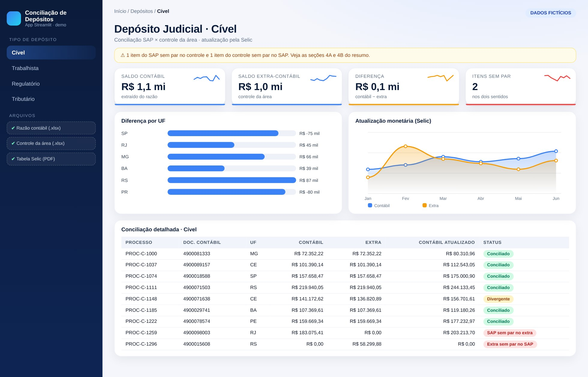<br><b>01 · Conciliação de Depósitos Judiciais</b></a></td><td align='center' width='25%'><a href='projects/contingencias-judiciais/README.md'>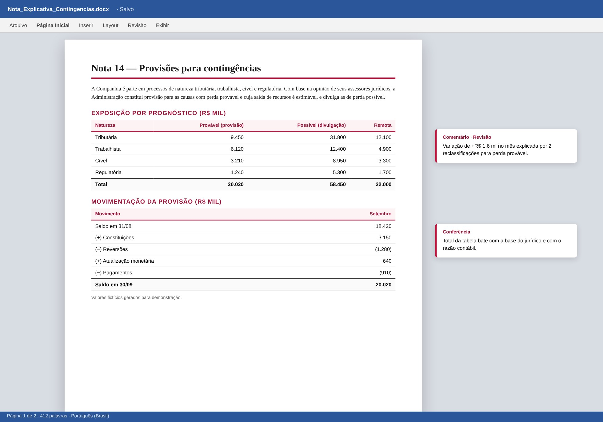<br><b>02 · Contingências Judiciais</b></a></td><td align='center' width='25%'><a href='projects/provisoes-opex-capex/README.md'>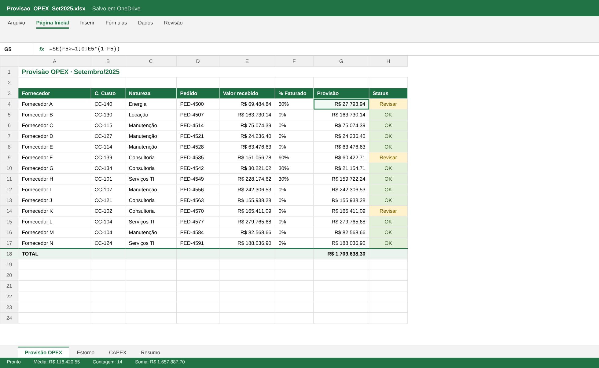<br><b>03 · Provisões OPEX e CAPEX</b></a></td><td align='center' width='25%'><a href='projects/relatorios-capex/README.md'>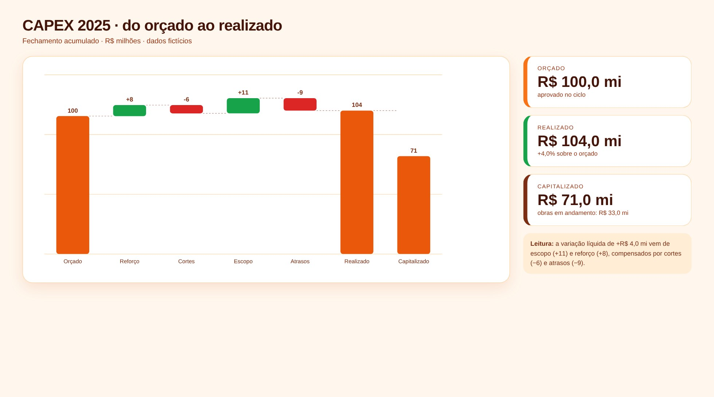<br><b>04 · Relatórios CAPEX: Fechamento e Justificativa</b></a></td></tr><tr><td align='center' width='25%'><a href='projects/relatorio-lancamentos-manuais/README.md'>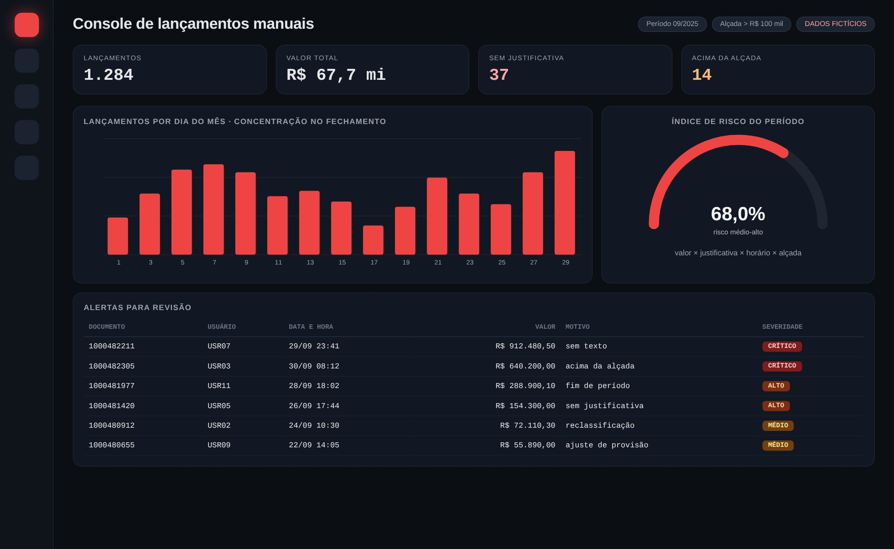<br><b>05 · Relatório de Lançamentos Manuais</b></a></td><td align='center' width='25%'><a href='projects/despesa-antecipada/README.md'>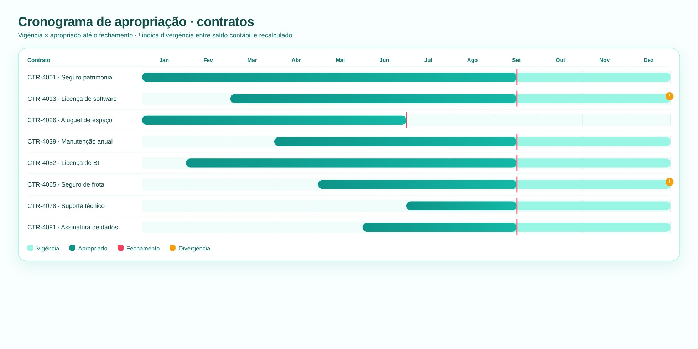<br><b>06 · Despesa Antecipada: Conciliação, Vigência e Relatório Trimestral</b></a></td><td align='center' width='25%'><a href='projects/deposito-caucao/README.md'>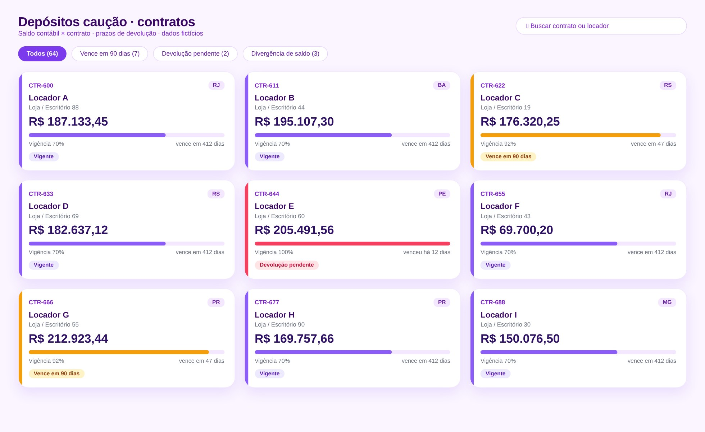<br><b>07 · Depósito Caução</b></a></td><td align='center' width='25%'><a href='projects/analise-contas-bancarias/README.md'>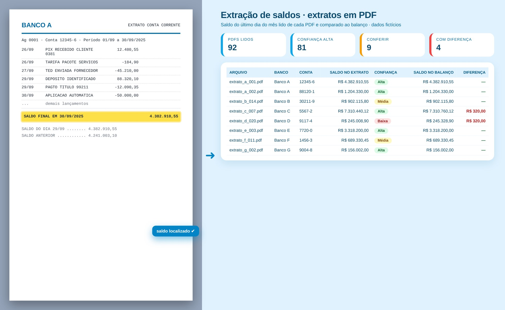<br><b>08 · Análise de Contas Bancárias</b></a></td></tr><tr><td align='center' width='25%'><a href='projects/lancamento-docas/README.md'>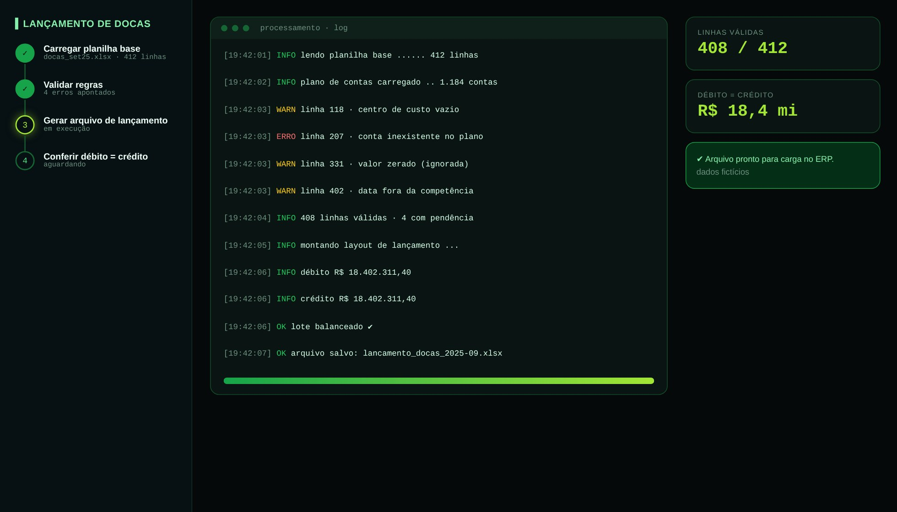<br><b>09 · Lançamento de Docas</b></a></td><td align='center' width='25%'><a href='projects/dashboards-html/README.md'>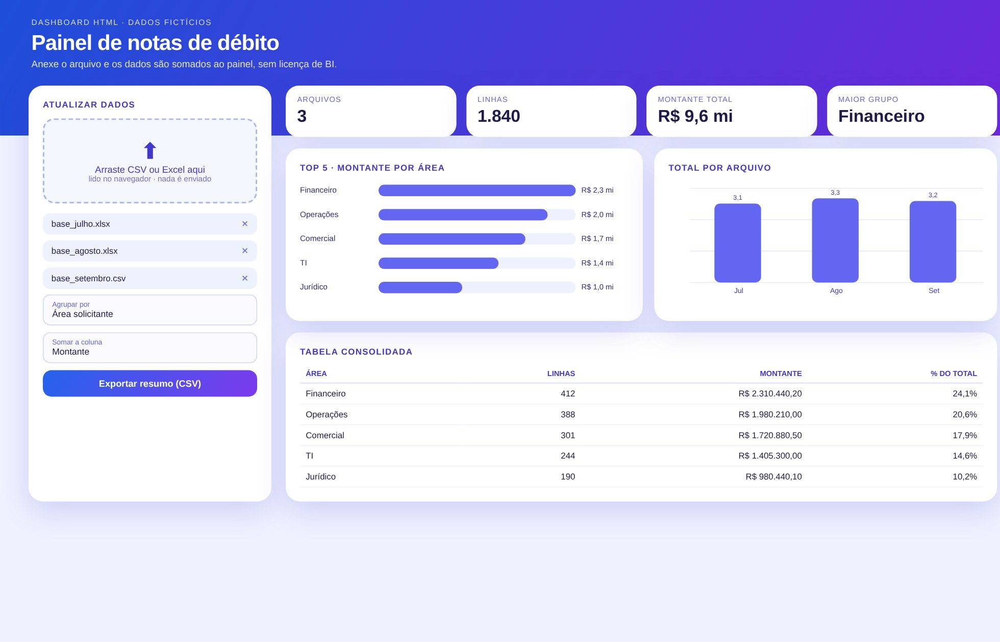<br><b>10 · Dashboards em HTML</b></a></td><td align='center' width='25%'><a href='projects/digital-inventory/README.md'>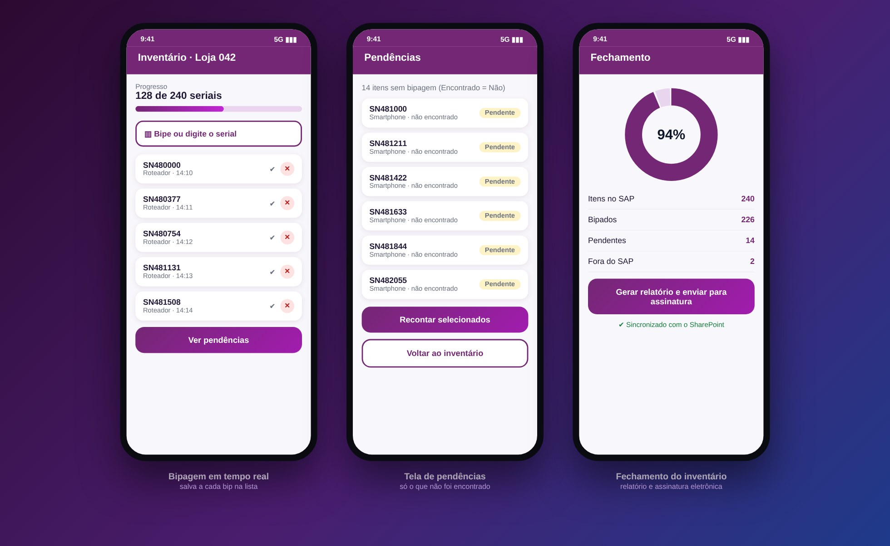<br><b>11 · App Digital Inventory</b></a></td><td align='center' width='25%'><a href='projects/saneamento-bases-dados/README.md'>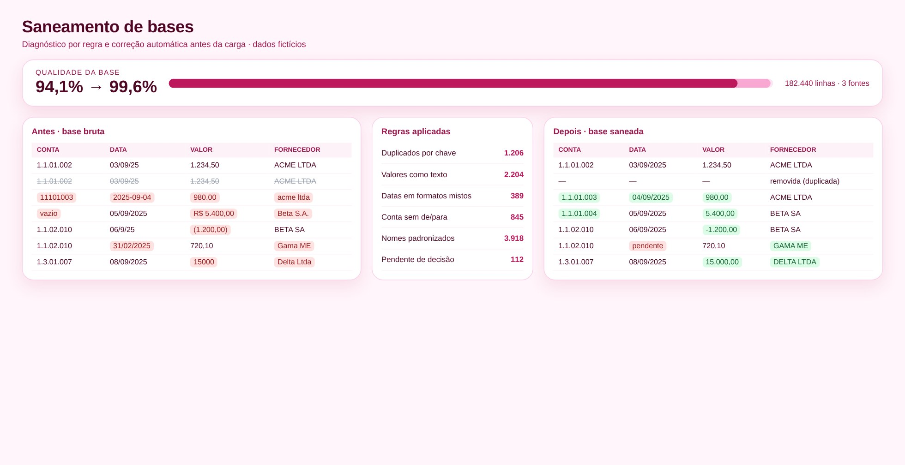<br><b>12 · Saneamento de Bases de Dados</b></a></td></tr><tr><td align='center' width='25%'><a href='projects/apuracao-tributos/README.md'>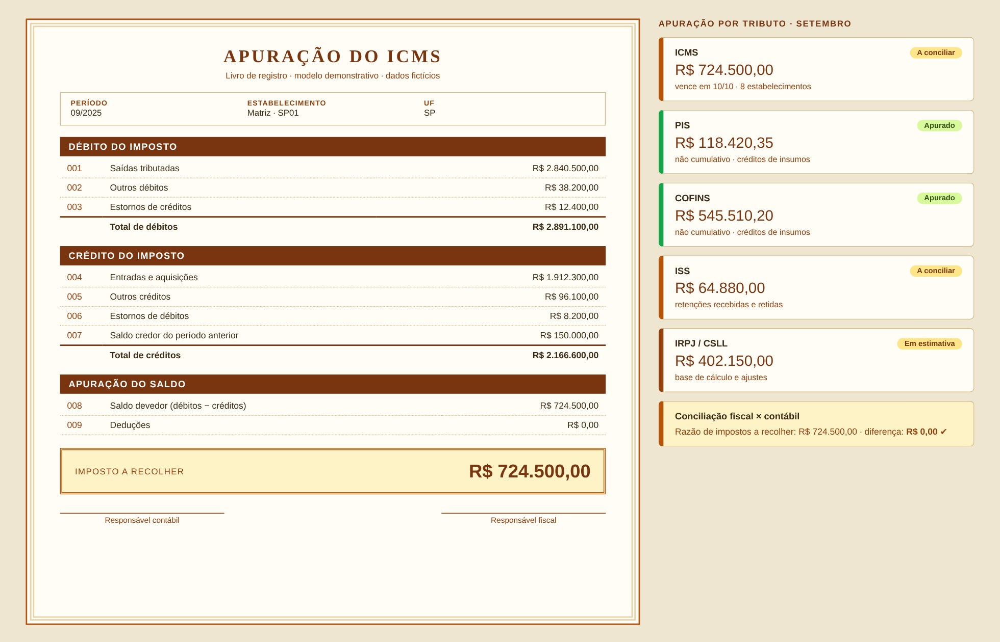<br><b>13 · Apuração de Tributos</b></a></td><td align='center' width='25%'><a href='projects/calculo-icms/README.md'>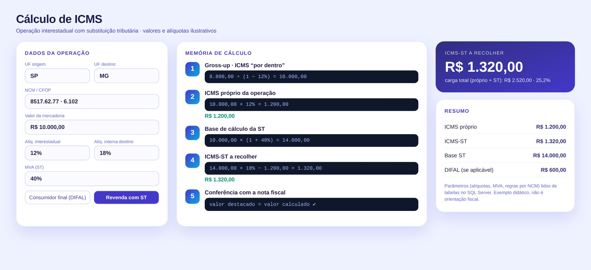<br><b>14 · Cálculo de ICMS</b></a></td><td align='center' width='25%'><a href='projects/reforma-tributaria/README.md'>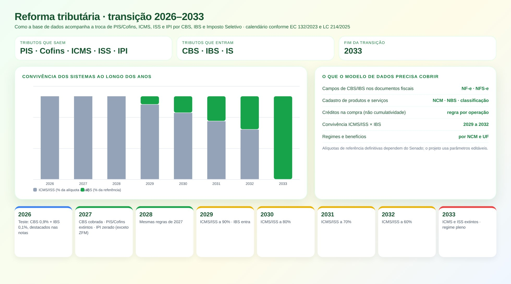<br><b>15 · Reforma Tributária: Transição e Simulador</b></a></td><td align='center' width='25%'><a href='projects/migracao-banco-dados/README.md'>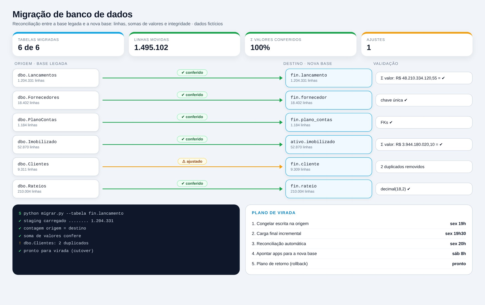<br><b>16 · Migração de Banco de Dados</b></a></td></tr></table>

| # | Projeto | Tipo de tela | Área |
|---|---|---|---|
| 01 | [Conciliação de Depósitos Judiciais](projects/conciliacao-depositos-judiciais/README.md) | App Streamlit | Judicial |
| 02 | [Contingências Judiciais](projects/contingencias-judiciais/README.md) | Documento + mapa de risco | Judicial |
| 03 | [Provisões OPEX e CAPEX](projects/provisoes-opex-capex/README.md) | Planilhas Excel | Provisões e CAPEX |
| 04 | [Relatórios CAPEX: Fechamento e Justificativa](projects/relatorios-capex/README.md) | Waterfall + Kanban | Provisões e CAPEX |
| 05 | [Relatório de Lançamentos Manuais](projects/relatorio-lancamentos-manuais/README.md) | Console de auditoria | Controles e conciliações |
| 06 | [Despesa Antecipada: Conciliação, Vigência e Relatório Trimestral](projects/despesa-antecipada/README.md) | Calculadora + Gantt | Controles e conciliações |
| 07 | [Depósito Caução](projects/deposito-caucao/README.md) | Cartões de contratos | Controles e conciliações |
| 08 | [Análise de Contas Bancárias](projects/analise-contas-bancarias/README.md) | PDF → dados | Controles e conciliações |
| 09 | [Lançamento de Docas](projects/lancamento-docas/README.md) | Wizard + log | Controles e conciliações |
| 10 | [Dashboards em HTML](projects/dashboards-html/README.md) | Dashboard HTML | Dados e plataformas |
| 11 | [App Digital Inventory](projects/digital-inventory/README.md) | Power Apps · Power Automate · SharePoint | Dados e plataformas |
| 12 | [Saneamento de Bases de Dados](projects/saneamento-bases-dados/README.md) | Antes × depois | Dados e plataformas |
| 13 | [Apuração de Tributos](projects/apuracao-tributos/README.md) | Livro de apuração | Fiscal e tributário |
| 14 | [Cálculo de ICMS](projects/calculo-icms/README.md) | Calculadora + mapa de UFs | Fiscal e tributário |
| 15 | [Reforma Tributária: Transição e Simulador](projects/reforma-tributaria/README.md) | Linha do tempo + simulador | Fiscal e tributário |
| 16 | [Migração de Banco de Dados](projects/migracao-banco-dados/README.md) | Reconciliação origem × destino | Dados e plataformas |

## Dashboards em temas diferentes

<table><tr><td align='center' width='33%'>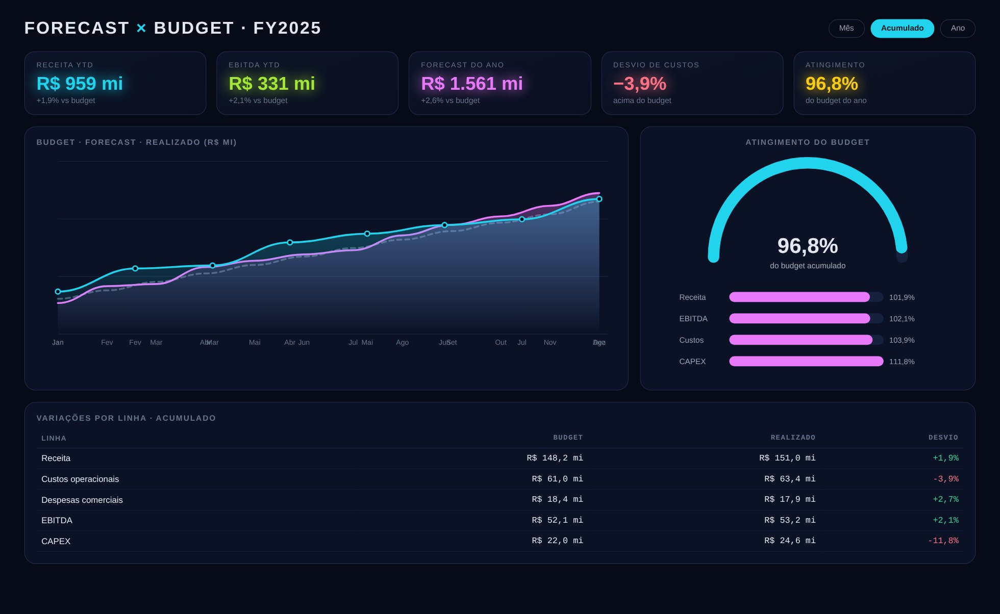<br><sub>Forecast × Budget · Neon escuro</sub></td><td align='center' width='33%'>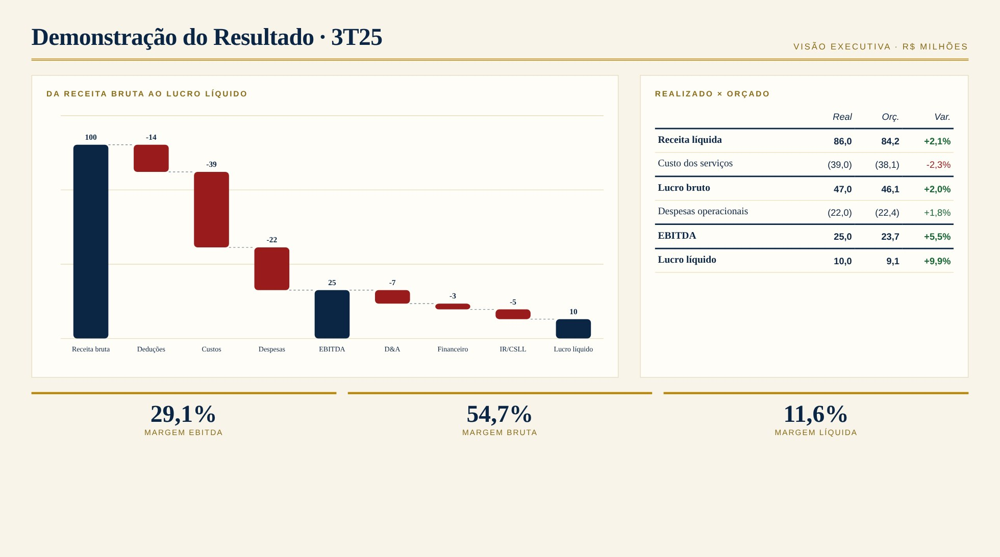<br><sub>DRE executiva · Editorial</sub></td><td align='center' width='33%'>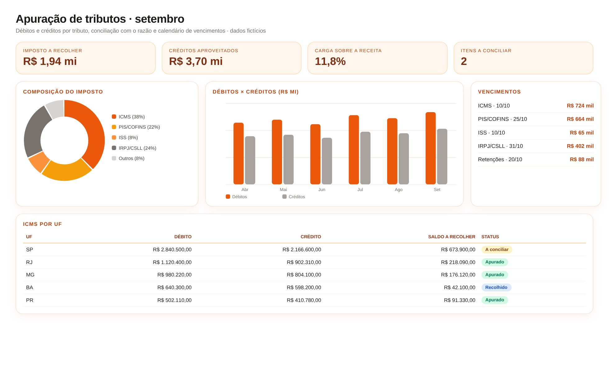<br><sub>Apuração de tributos · Laranja claro</sub></td></tr><tr><td align='center' width='33%'>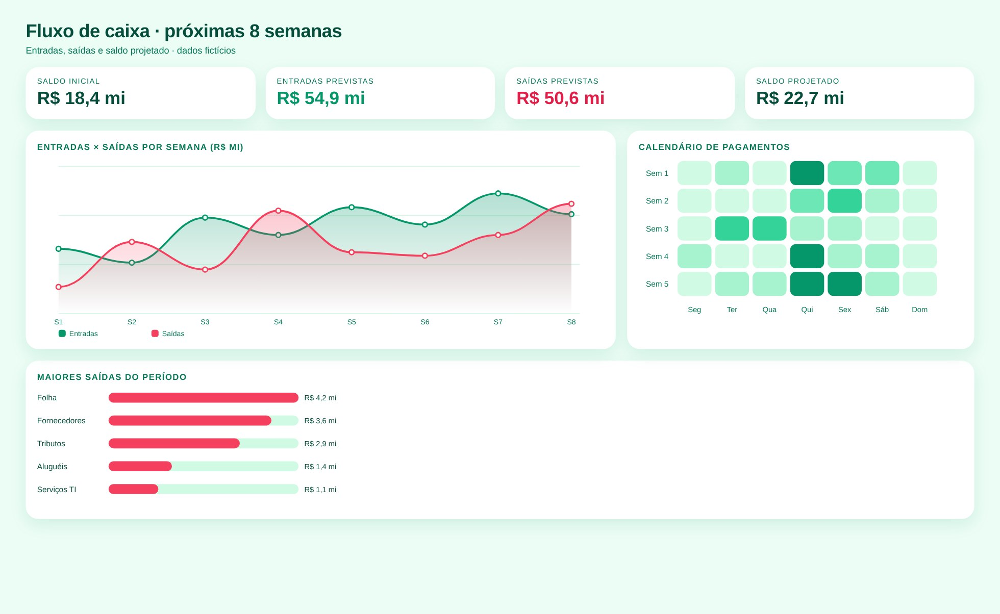<br><sub>Fluxo de caixa · Verde menta</sub></td><td align='center' width='33%'>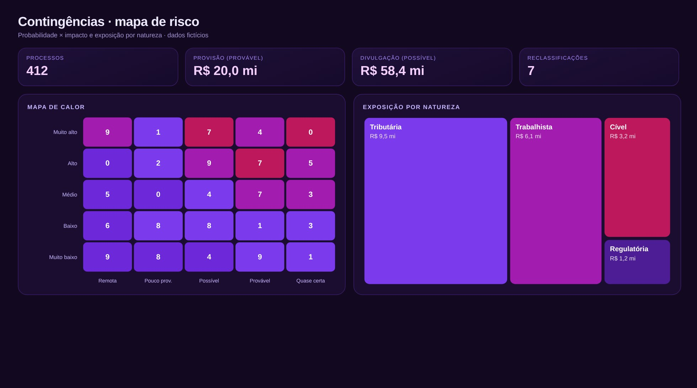<br><sub>Contingências · mapa de risco · Roxo escuro</sub></td><td align='center' width='33%'>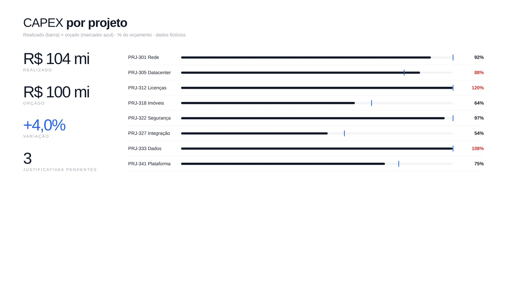<br><sub>CAPEX por projeto · Minimalista</sub></td></tr><tr><td align='center' width='33%'>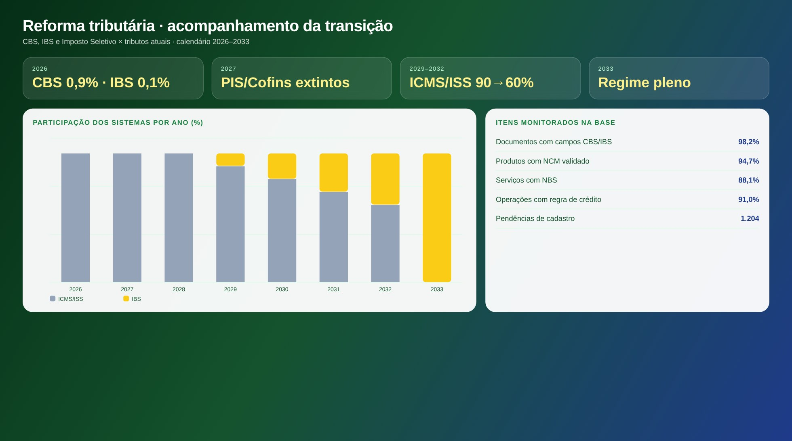<br><sub>Reforma tributária · Gradiente</sub></td><td align='center' width='33%'>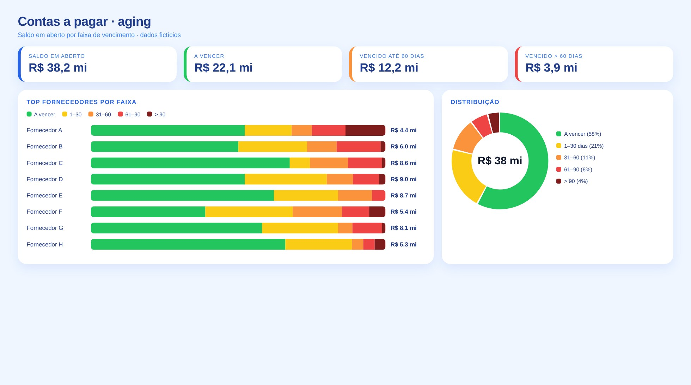<br><sub>Contas a pagar · aging · Azul claro</sub></td><td align='center' width='33%'>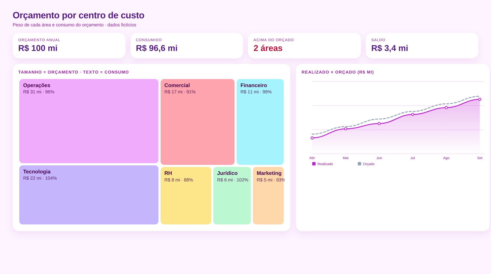<br><sub>Orçamento por centro de custo · Pastel</sub></td></tr></table>

## Mapa: o que foi automatizado × projeto

| Automação | Projeto |
|---|---|
| Depósito Tributário, Depósito Trabalhista, Depósito Regulatório, Depósito Civil | Conciliação de Depósitos Judiciais |
| Contingência Tributária, Contingência Trabalhista, Contingência Regulatória, Contingência Civil | Contingências Judiciais |
| Provisão OPEX, Provisão CAPEX | Provisões OPEX e CAPEX |
| Relatório de Fechamento CAPEX, Relatório de Justificativa CAPEX | Relatórios CAPEX: Fechamento e Justificativa |
| Relatório de Lançamentos Manuais | Relatório de Lançamentos Manuais |
| Conciliação de Despesa Antecipada, Calculadora de Vigência, Relatório de Despesa Antecipada Trimestral | Despesa Antecipada: Conciliação, Vigência e Relatório Trimestral |
| Depósito Caução | Depósito Caução |
| Análise de Contas de Banco | Análise de Contas Bancárias |
| Lançamento Docas | Lançamento de Docas |
| Dashboards | Dashboards em HTML |
| App Digital Inventory | App Digital Inventory |
| Saneamento de bases de dados | Saneamento de Bases de Dados |
| Apuração de tributos | Apuração de Tributos |
| Cálculo de ICMS | Cálculo de ICMS |
| Reforma tributária | Reforma Tributária: Transição e Simulador |
| Migração de banco de dados | Migração de Banco de Dados |

## Sobre os dados

> Todas as telas deste repositório usam **dados sintéticos** gerados por script (`tools/`), com uma empresa fictícia. Não há dados, contas, processos, fornecedores ou documentos reais de nenhum empregador.

## Como regenerar tudo

```bash
pip install playwright && playwright install chromium
python tools/run_all.py              # telas
python tools/build_site.py --pdf     # site, READMEs e PDF a partir de tools/data.py
```
