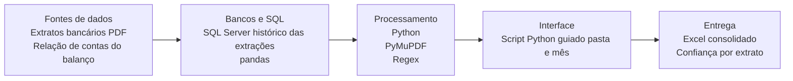
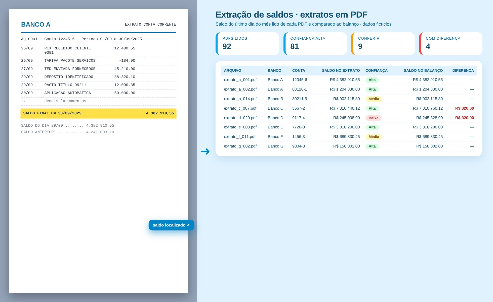

# Análise de Contas Bancárias

> Lê o saldo de dezenas de extratos em PDF de vários bancos e compara com o balanço.

**Tipo de tela:** PDF → dados

   

[Ver esta página no site](https://mv-dev-finance.github.io/Portfolio_Automacoes_Financeiras/projects/analise-contas-bancarias.html) · [Voltar ao portfólio](../../README.md)

## 1. Lógica do negócio

A conciliação bancária compara o saldo do extrato, no último dia do mês, com o saldo contábil da conta. As diferenças costumam ser lançamentos pendentes ou erros. O gargalo é que os extratos chegam em PDF e cada banco tem seu próprio layout, às vezes mais de um por banco.

**Regras que governam o processo**

- No último dia do mês, saldo do extrato = saldo do balanço
- Sem movimento no dia, vale o último saldo anterior
- Cada banco tem layout e formato numérico próprios
- Contas com diferença precisam de explicação antes do fechamento

> **O problema:** Mais de 90 extratos por mês, de cerca de 20 bancos, abertos um a um. O AI Builder do Power Automate exigia um modelo por layout e não deu conta de bancos com mais de 4 modelos.

## 2. Como resolvi com dados

1. **Leitura**: Extraio o texto dos PDFs com PyMuPDF; os escaneados são sinalizados.
2. **Regras genéricas**: Em vez de um modelo por banco, busco linhas de saldo e a coluna de saldo dos extratos corridos.
3. **Data de corte**: Escolho o saldo mais recente até o último dia do mês e converto o formato numérico brasileiro.
4. **Comparação**: Cruzo com a relação de contas do balanço e marco as diferenças.
5. **Entrega**: Excel com resumo, confiança (alta, média, baixa), linha encontrada e candidatos.

## 3. Tecnologias utilizadas

| Camada | Tecnologias |
|---|---|
| Fontes de dados | Extratos bancários (PDF), Relação de contas do balanço |
| Bancos e SQL | SQL Server (histórico das extrações), pandas |
| Processamento | Python, PyMuPDF, Regex, pandas, openpyxl |
| Interface | Script Python guiado (pasta e mês) |
| Entrega | Excel consolidado, Confiança por extrato |

## 4. Funcionalidades

- Leitura em lote de PDFs de vários layouts
- Confiança alta, média ou baixa por saldo
- Trecho do PDF de onde saiu o valor
- Contas sem extrato e extratos sem conta

## IA aplicada neste projeto

Testes com PDFs simulados de layouts diferentes para validar a leitura do saldo antes de usar nos extratos reais.

## Telas

**Extração**

## Quem fez

**Miguel Vinicius Moura Martins**: Defini a regra de negócio, modelei os dados, validei os números contra o processo manual e desenvolvi a ferramenta com apoio de IA.

> Todas as telas usam dados sintéticos de uma empresa fictícia.
