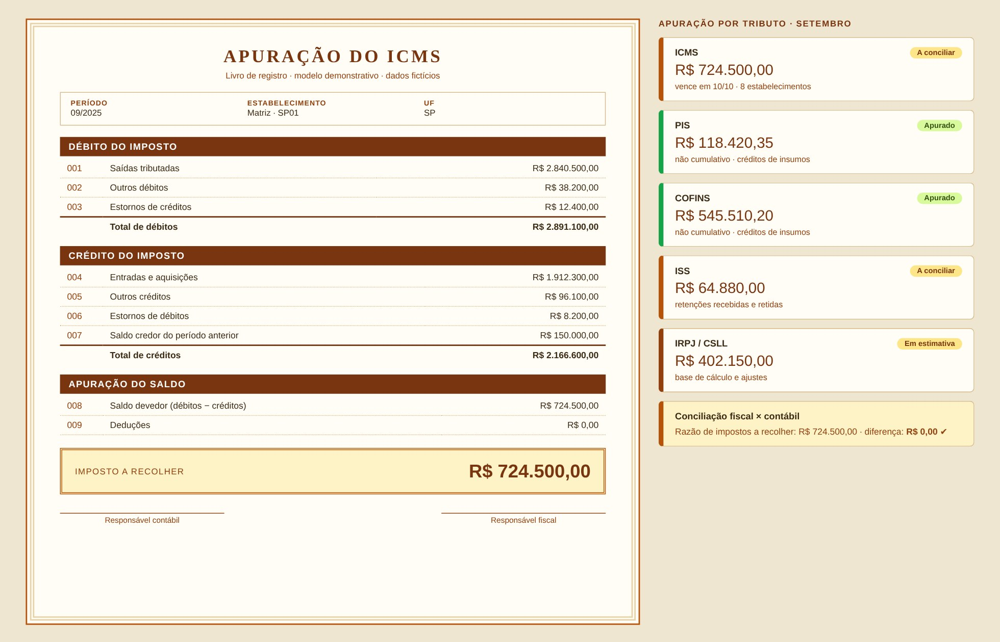

# Apuração de Tributos

> Débitos, créditos e saldo a recolher por tributo, conciliados com o razão contábil.

**Tipo de tela:** Livro de apuração

      

[Ver esta página no site](https://mv-dev-finance.github.io/Portfolio_Automacoes_Financeiras/projects/apuracao-tributos.html) · [Voltar ao portfólio](../../README.md)

## 1. Lógica do negócio

Apuração é o cálculo periódico do imposto a recolher: débitos (sobre saídas e receitas) menos créditos (sobre entradas e insumos), por tributo, estabelecimento e período. O resultado é um saldo a recolher ou um crédito a transportar, e precisa bater com o razão contábil e com as obrigações acessórias.

**Regras que governam o processo**

- Saldo = débitos − créditos, por tributo e por estabelecimento
- Crédito depende de documento fiscal válido e da natureza da operação
- O regime define a regra: cumulativo ou não cumulativo
- Fiscal e contábil precisam conciliar (impostos a recolher e a recuperar)

> **O problema:** Reunir notas, livros e ajustes de vários estabelecimentos em planilhas, com risco de crédito indevido e diferença entre o fiscal e o contábil.

## 2. Como resolvi com dados

1. **Extração**: Notas (XML), livros fiscais e razão contábil do período.
2. **Padronização**: Normalizo CFOP, CST, NCM e UF e valido a chave dos documentos.
3. **Cálculo**: Débito e crédito por tributo e estabelecimento, com estornos e ajustes.
4. **Conciliação**: Comparo o saldo apurado com o razão de impostos a recolher e a recuperar.
5. **Entrega**: Livro de apuração, valor a recolher, pendências e calendário de vencimentos.

## 3. Tecnologias utilizadas

| Camada | Tecnologias |
|---|---|
| Fontes de dados | NF-e (XML), Livros fiscais (SAP), Excel |
| Bancos e SQL | SQL Server (staging fiscal), pandas |
| Processamento | Python, pandas, Decimal |
| Interface | Streamlit |
| Entrega | Excel de apuração, Conciliação fiscal × contábil, Valor a recolher |
| Automação | Power Automate (alerta de vencimentos) |

## 4. Funcionalidades

- Apuração por tributo e estabelecimento
- Conciliação fiscal × contábil
- Estornos e saldos credores
- Calendário de vencimentos
- Pendências por documento

## IA aplicada neste projeto

Cenários de débito e crédito com estornos, créditos extemporâneos e saldos credores.

## Telas

**Livro de apuração**

## Quem fez

**Miguel Vinicius Moura Martins**: Defini a regra de negócio, modelei os dados, validei os números contra o processo manual e desenvolvi a ferramenta com apoio de IA.

> Todas as telas usam dados sintéticos de uma empresa fictícia.
