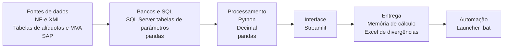
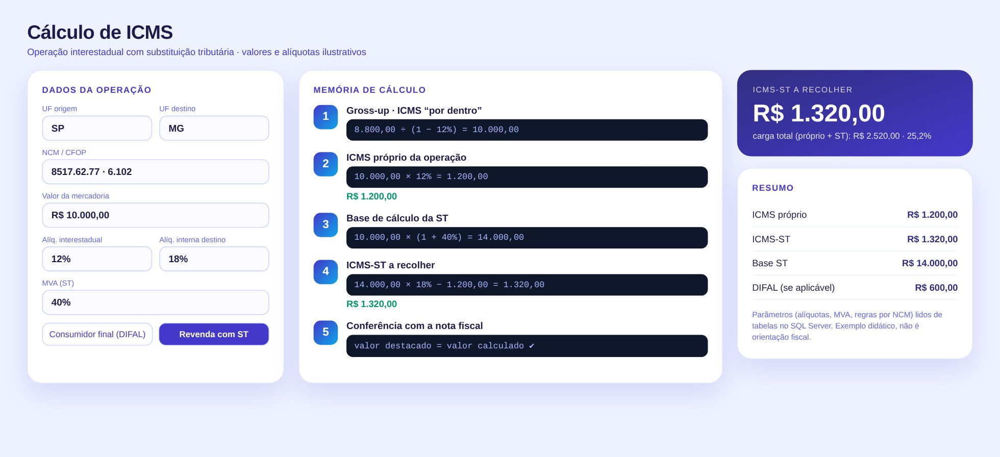
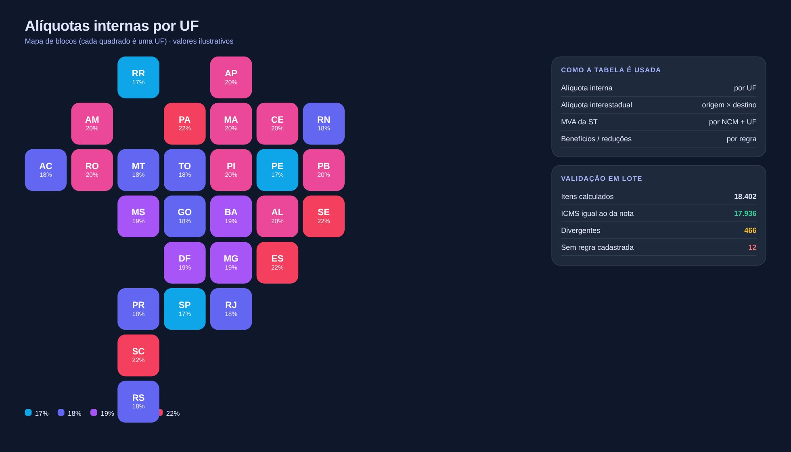

# Cálculo de ICMS

> Calculadora e validação em lote de ICMS próprio, DIFAL e substituição tributária.

**Tipo de tela:** Calculadora + mapa de UFs

     

[Ver esta página no site](https://mv-dev-finance.github.io/Portfolio_Automacoes_Financeiras/projects/calculo-icms.html) · [Voltar ao portfólio](../../README.md)

## 1. Lógica do negócio

O ICMS é um imposto estadual sobre a circulação de mercadorias e serviços e é calculado “por dentro”: o próprio imposto compõe a base. A alíquota depende da UF e da operação (interna ou interestadual). Em operações sujeitas a substituição tributária, a base é ajustada por uma margem (MVA) e o imposto é recolhido antecipadamente.

**Regras que governam o processo**

- ICMS “por dentro”: a base inclui o próprio imposto
- Alíquota interna ou interestadual conforme origem e destino
- ST: base = valor × (1 + MVA) e ICMS-ST = base × alíquota interna − ICMS próprio
- Parâmetros variam por UF, NCM e regime e precisam estar versionados

> **O problema:** Calcular na mão ou em planilhas com regras espalhadas, sem rastro do porquê de cada valor e sem comparar com o que foi destacado na nota.

## 2. Como resolvi com dados

1. **Parâmetros**: Tabelas de alíquotas, MVA e regras por UF e NCM em SQL Server.
2. **Regras de cálculo**: ICMS próprio, DIFAL e ST implementados com Decimal para não perder centavos.
3. **Cálculo em lote**: Recalculo item a item a partir do XML da nota.
4. **Conferência**: Comparo com o valor destacado e com a apuração no SAP.
5. **Entrega**: Memória de cálculo, lista de divergências e itens sem regra cadastrada.

## 3. Tecnologias utilizadas

| Camada | Tecnologias |
|---|---|
| Fontes de dados | NF-e (XML), Tabelas de alíquotas e MVA, SAP |
| Bancos e SQL | SQL Server (tabelas de parâmetros), pandas |
| Processamento | Python, Decimal, pandas |
| Interface | Streamlit |
| Entrega | Memória de cálculo, Excel de divergências |
| Automação | Launcher .bat |

## 4. Funcionalidades

- Calculadora com memória de cálculo passo a passo
- ICMS próprio, DIFAL e ST
- Validação em lote contra a nota fiscal
- Mapa de alíquotas por UF
- Itens sem regra cadastrada

## IA aplicada neste projeto

Casos de borda por UF, ST com MVA e arredondamento com Decimal. Os valores da tela são ilustrativos.

## Telas

**Calculadora**

**Mapa de alíquotas**

## Quem fez

**Miguel Vinicius Moura Martins**: Defini a regra de negócio, modelei os dados, validei os números contra o processo manual e desenvolvi a ferramenta com apoio de IA.

> Todas as telas usam dados sintéticos de uma empresa fictícia.
