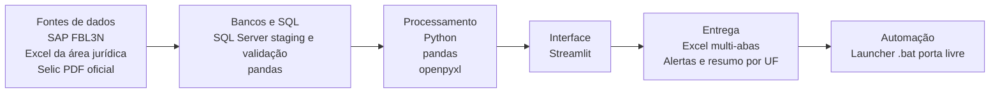
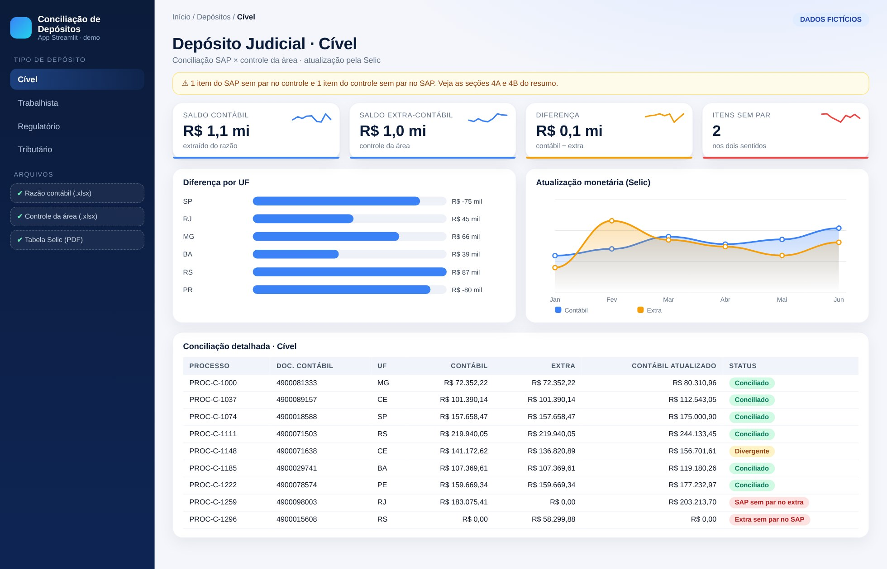
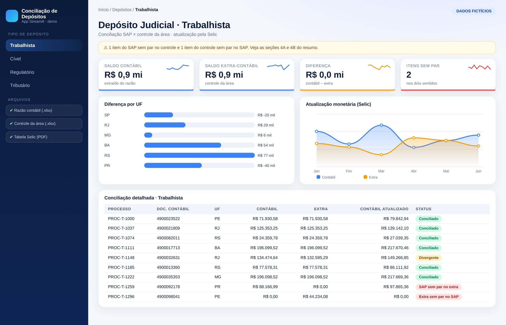
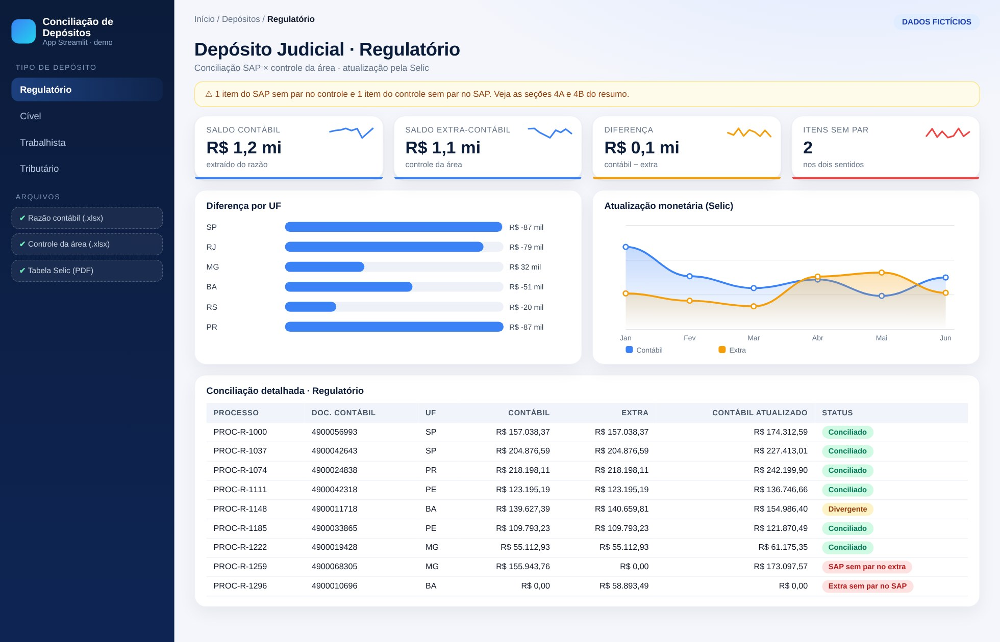
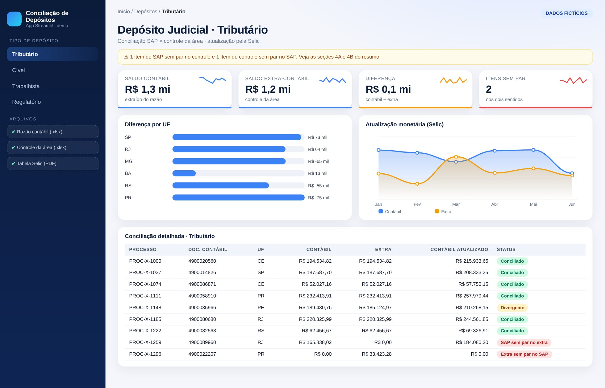

# Conciliação de Depósitos Judiciais

> App único com seletor de tipo: Trabalhista, Regulatório, Cível e Tributário.

**Tipo de tela:** App Streamlit

     

[Ver esta página no site](https://mv-dev-finance.github.io/Portfolio_Automacoes_Financeiras/projects/conciliacao-depositos-judiciais.html) · [Voltar ao portfólio](../../README.md)

## 1. Lógica do negócio

Quando a empresa é parte em um processo, pode precisar depositar valores em juízo como garantia. Esse dinheiro continua sendo dela até o desfecho, então fica no ativo e é atualizado monetariamente (Selic) até ser levantado ou convertido em pagamento.

**Regras que governam o processo**

- O saldo do razão (SAP) precisa bater com o controle da área jurídica, depósito a depósito
- A atualização segue a Selic acumulada desde a data do depósito até o fechamento
- Diferenças podem ser depósito sem controle, controle sem lançamento ou valor divergente
- A análise gerencial é feita por UF, via centro de custo

> **O problema:** Cruzar milhares de linhas entre SAP, planilha da área e análise do mês anterior à mão, com macros pesadas e difíceis de auditar.

## 2. Como resolvi com dados

1. **Extração**: Razão do SAP (FBL3N) e controle da área em Excel, mais a análise do mês anterior como base.
2. **Padronização**: Normalizo chaves, valores e datas e leio a tabela da Selic direto do PDF oficial.
3. **Cruzamento nos dois sentidos**: Full join entre contábil e extra: SAP sem par no controle e controle sem par no SAP, cada um com motivo.
4. **Cálculo**: Atualização monetária pela Selic acumulada e comparação com o saldo contábil, por processo.
5. **Entrega**: Planilha de análise com capa, balanço, bases e resumo por UF, com alertas e cores, sem macro.

## 3. Tecnologias utilizadas

| Camada | Tecnologias |
|---|---|
| Fontes de dados | SAP (FBL3N), Excel da área jurídica, Selic (PDF oficial) |
| Bancos e SQL | SQL Server (staging e validação), pandas |
| Processamento | Python, pandas, openpyxl, PyMuPDF |
| Interface | Streamlit |
| Entrega | Excel multi-abas, Alertas e resumo por UF |
| Automação | Launcher .bat (porta livre) |

## 4. Funcionalidades

- Validação nos dois sentidos, com motivo e linha de origem
- Atualização pela Selic calculada pelo próprio app
- Resumo por UF com centro de custo mapeado
- Planilha final no padrão de análise da área
- Alertas e cores nas bases
- Histórico recolhido e cartões de resumo

## IA aplicada neste projeto

Cenários de teste com itens sem par, diferenças de centavos e Selic na virada do mês, além de revisão do código de cruzamento.

## Telas

**Cível**

**Trabalhista**

**Regulatório**

**Tributário**

## Quem fez

**Miguel Vinicius Moura Martins**: Defini a regra de negócio, modelei os dados, validei os números contra o processo manual e desenvolvi a ferramenta com apoio de IA.

> Todas as telas usam dados sintéticos de uma empresa fictícia.
