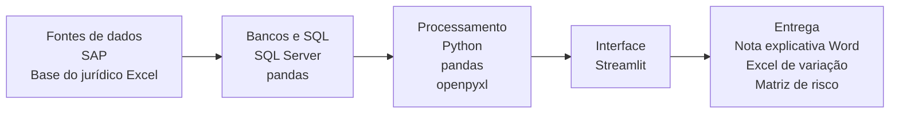
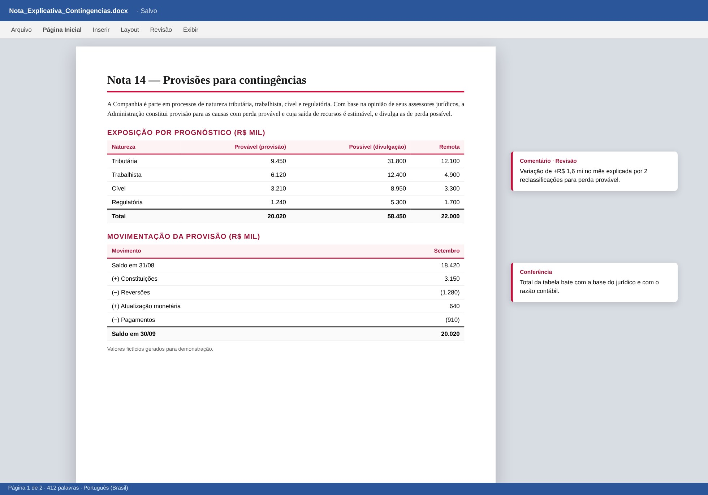
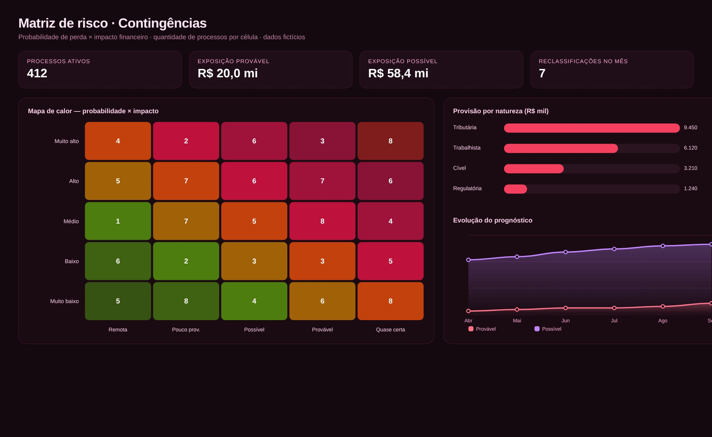

# Contingências Judiciais

> Classificação de risco e provisão para as naturezas Tributária, Trabalhista, Regulatória e Cível.

**Tipo de tela:** Documento + mapa de risco

     

[Ver esta página no site](https://mv-dev-finance.github.io/Portfolio_Automacoes_Financeiras/projects/contingencias-judiciais.html) · [Voltar ao portfólio](../../README.md)

## 1. Lógica do negócio

Contingência é uma possível obrigação futura decorrente de processos. Pelo CPC 25, se a perda é provável e o valor é estimável, reconhece-se uma provisão no passivo. Se é possível, apenas divulga-se em nota explicativa. Se é remota, nada é registrado.

**Regras que governam o processo**

- Provável: provisão no balanço
- Possível: divulgação em nota explicativa
- Remota: sem registro
- A cada mês, a provisão varia por constituição, reversão, atualização e baixa

> **O problema:** Garantir que o saldo contábil reflita a estimativa do jurídico e explicar a variação do mês para a gestão e para a auditoria.

## 2. Como resolvi com dados

1. **Extração**: Base de processos do jurídico e saldo do razão contábil.
2. **Classificação**: Aplico o prognóstico e separo o que é provisão do que é divulgação.
3. **Reconciliação**: Comparo saldo contábil e estimativa do jurídico por processo e natureza.
4. **Abertura da variação**: Decomponho o movimento em constituição, reversão, atualização e baixa.
5. **Entrega**: Nota explicativa em Word, matriz de risco e base para o lançamento.

## 3. Tecnologias utilizadas

| Camada | Tecnologias |
|---|---|
| Fontes de dados | SAP, Base do jurídico (Excel) |
| Bancos e SQL | SQL Server, pandas |
| Processamento | Python, pandas, openpyxl, python-docx |
| Interface | Streamlit |
| Entrega | Nota explicativa (Word), Excel de variação, Matriz de risco |

## 4. Funcionalidades

- Classificação por prognóstico
- Provisão contábil × estimativa do jurídico
- Abertura da variação do mês
- Nota explicativa gerada em Word
- Matriz de risco probabilidade × impacto

## IA aplicada neste projeto

Casos de borda de reclassificação de risco e testes da abertura de variação entre meses.

## Telas

**Nota explicativa**

**Matriz de risco**

## Quem fez

**Miguel Vinicius Moura Martins**: Defini a regra de negócio, modelei os dados, validei os números contra o processo manual e desenvolvi a ferramenta com apoio de IA.

> Todas as telas usam dados sintéticos de uma empresa fictícia.
