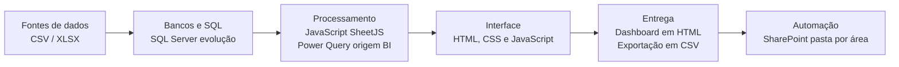
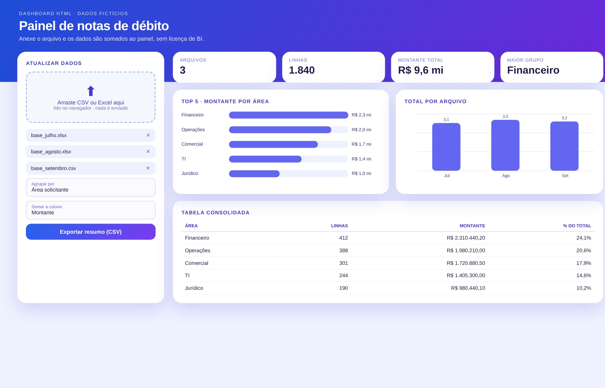

# Dashboards em HTML

> Painéis compartilháveis sem licença de BI: o arquivo é carregado e os dados somam ao painel.

**Tipo de tela:** Dashboard HTML

  

[Ver esta página no site](https://mv-dev-finance.github.io/Portfolio_Automacoes_Financeiras/projects/dashboards-html.html) · [Voltar ao portfólio](../../README.md)

## 1. Lógica do negócio

A gestão precisa acompanhar números rapidamente, mas compartilhar dashboards de Power BI depende de licenças e de um fluxo de atualização. A saída foi levar a visualização para HTML, que abre em qualquer navegador e atualiza com um arquivo.

**Regras que governam o processo**

- Os mesmos indicadores do Power BI, em formato leve e compartilhável
- A atualização não pode depender de licença individual
- Cada área atualiza o seu painel com um arquivo padronizado
- Evolução: dados em SQL Server, lidos por uma API

> **O problema:** Dificuldade de compartilhar e atualizar dashboards sem Power BI Pro para todos. Uma pessoa atualizava tudo e as áreas não entendiam de dados.

## 2. Como resolvi com dados

1. **Mapeamento**: Defino quais dashboards do Power BI valem a migração.
2. **Modelagem**: Preparo os dados em Excel e SQL no formato que o painel consome.
3. **Painel em HTML**: KPIs, gráficos e tabelas em um único arquivo.
4. **Atualização**: Upload de CSV/XLSX soma os dados no navegador, aceitando números no formato brasileiro.
5. **Evolução**: Painel → API Python → SQL Server, com upload mensal validado.

## 3. Tecnologias utilizadas

| Camada | Tecnologias |
|---|---|
| Fontes de dados | CSV / XLSX |
| Bancos e SQL | SQL Server (evolução) |
| Processamento | JavaScript (SheetJS), Power Query (origem BI) |
| Interface | HTML, CSS e JavaScript |
| Entrega | Dashboard em HTML, Exportação em CSV |
| Automação | SharePoint (pasta por área) |

## 4. Funcionalidades

- Upload por arraste de arquivo
- KPIs e gráficos atualizados na hora
- Um único arquivo HTML, fácil de compartilhar
- Agrupar por qualquer coluna e somar qualquer valor

## IA aplicada neste projeto

Apoio na construção da interface e nos testes de leitura de números no formato brasileiro.

## Telas

**Painel com upload**

## Quem fez

**Miguel Vinicius Moura Martins**: Defini a regra de negócio, modelei os dados, validei os números contra o processo manual e desenvolvi a ferramenta com apoio de IA.

> Todas as telas usam dados sintéticos de uma empresa fictícia.
