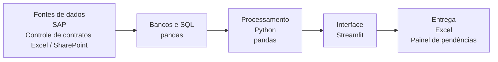
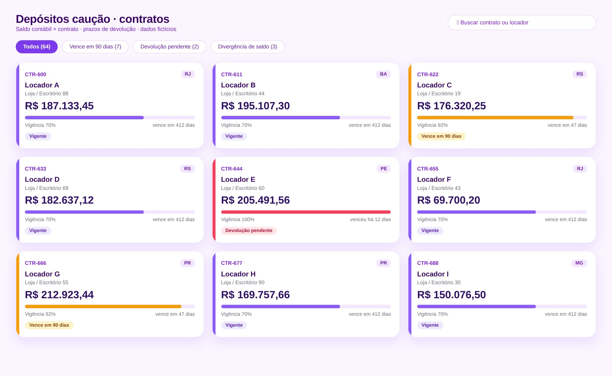

# Depósito Caução

> Conciliação do razão com o controle de contratos de locação.

**Tipo de tela:** Cartões de contratos

     

[Ver esta página no site](https://mv-dev-finance.github.io/Portfolio_Automacoes_Financeiras/projects/deposito-caucao.html) · [Voltar ao portfólio](../../README.md)

## 1. Lógica do negócio

Depósito caução é uma garantia dada em contratos, como os de locação. Fica no ativo, não vira despesa e é devolvido ao fim do contrato. O risco está em perder o prazo de devolução ou em ter saldo contábil diferente do contrato.

**Regras que governam o processo**

- O saldo contábil precisa bater com o valor de cada contrato
- Vencimentos próximos exigem ação antecipada
- Devoluções pendentes precisam ser cobradas do locador

> **O problema:** Faltava uma visão única do saldo, dos vencimentos e das devoluções pendentes.

## 2. Como resolvi com dados

1. **Extração**: Saldo do razão e controle de contratos.
2. **Cruzamento**: Comparo contrato a contrato e destaco diferenças.
3. **Prazos**: Calculo contratos vencendo em 90 dias e devoluções pendentes.
4. **Entrega**: Cartões por contrato com status e lista de ações.

## 3. Tecnologias utilizadas

| Camada | Tecnologias |
|---|---|
| Fontes de dados | SAP, Controle de contratos (Excel / SharePoint) |
| Bancos e SQL | pandas |
| Processamento | Python, pandas |
| Interface | Streamlit |
| Entrega | Excel, Painel de pendências |

## 4. Funcionalidades

- Saldo contábil × saldo dos contratos
- Alerta de vencimentos em 90 dias
- Controle de devoluções pendentes
- Cartões com status por contrato

## IA aplicada neste projeto

Cenários de vencimento na virada do ano e devoluções parciais.

## Telas

**Contratos**

## Quem fez

**Miguel Vinicius Moura Martins**: Defini a regra de negócio, modelei os dados, validei os números contra o processo manual e desenvolvi a ferramenta com apoio de IA.

> Todas as telas usam dados sintéticos de uma empresa fictícia.
