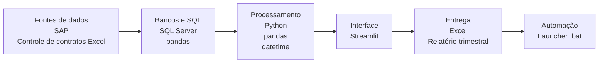
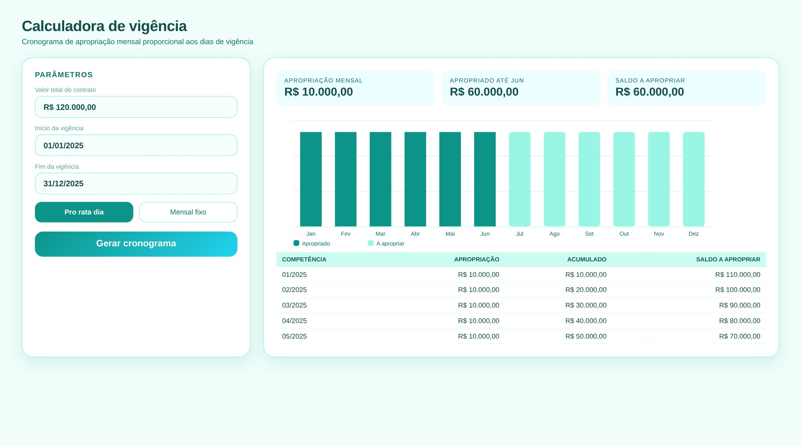
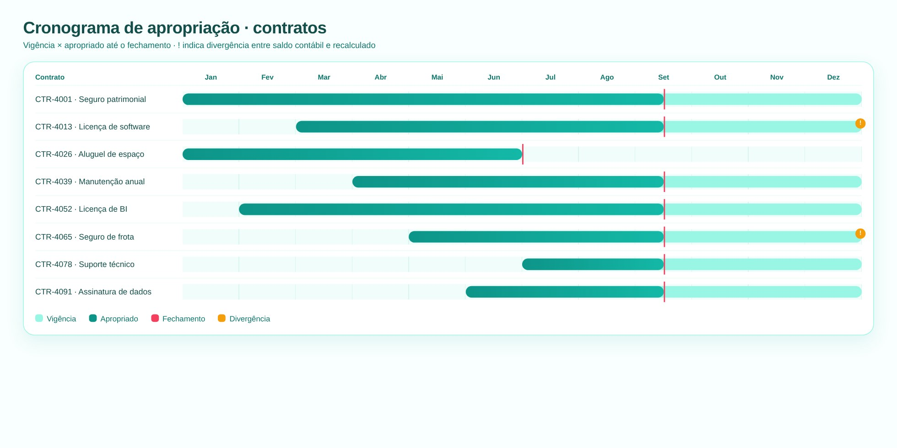
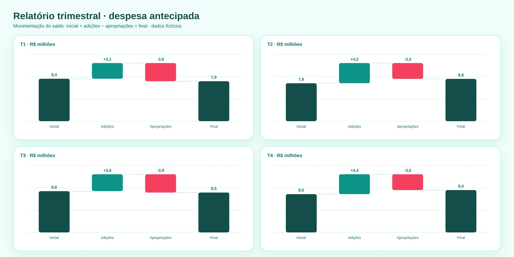

# Despesa Antecipada: Conciliação, Vigência e Relatório Trimestral

> Três ferramentas para controlar a apropriação de despesas pagas antecipadamente.

**Tipo de tela:** Calculadora + Gantt

     

[Ver esta página no site](https://mv-dev-finance.github.io/Portfolio_Automacoes_Financeiras/projects/despesa-antecipada.html) · [Voltar ao portfólio](../../README.md)

## 1. Lógica do negócio

Pagamentos adiantados, como seguros, licenças e aluguéis, são ativo porque o benefício ainda será consumido. A cada mês apropria-se para despesa a parte consumida, proporcional ao tempo de vigência, até zerar o saldo.

**Regras que governam o processo**

- Apropriação proporcional aos dias de vigência (pro rata dia)
- Saldo a apropriar = valor pago − valor já apropriado
- Vigências que começam ou terminam no meio do mês exigem cálculo por dias
- O saldo contábil precisa bater com o saldo recalculado por contrato

> **O problema:** Recalcular contrato a contrato e conciliar com o razão consumia muito tempo e era fácil errar vigência.

## 2. Como resolvi com dados

1. **Extração**: Contratos, datas de vigência, valores pagos e saldo do razão.
2. **Cálculo**: A calculadora gera o cronograma de apropriação pro rata dia.
3. **Conciliação**: Comparo o saldo recalculado com o saldo contábil por contrato.
4. **Divergências**: Marco no cronograma os contratos divergentes para ajuste.
5. **Relatório**: Resumo trimestral: saldo inicial, adições, apropriações e saldo final.

## 3. Tecnologias utilizadas

| Camada | Tecnologias |
|---|---|
| Fontes de dados | SAP, Controle de contratos (Excel) |
| Bancos e SQL | SQL Server, pandas |
| Processamento | Python, pandas, datetime |
| Interface | Streamlit |
| Entrega | Excel, Relatório trimestral |
| Automação | Launcher .bat |

## 4. Funcionalidades

- Apropriação mensal pro rata dia
- Cronograma visual dos contratos
- Saldo contábil × saldo recalculado
- Movimentação trimestral do saldo

## IA aplicada neste projeto

Testes de vigência: início e fim no meio do mês, ano bissexto e contratos de um único dia.

## Telas

**Calculadora de vigência**

**Cronograma dos contratos**

**Relatório trimestral**

## Quem fez

**Miguel Vinicius Moura Martins**: Defini a regra de negócio, modelei os dados, validei os números contra o processo manual e desenvolvi a ferramenta com apoio de IA.

> Todas as telas usam dados sintéticos de uma empresa fictícia.
