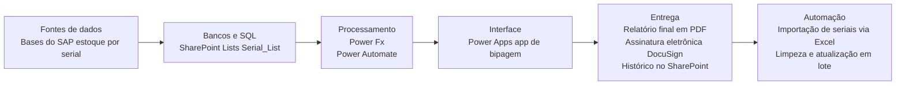
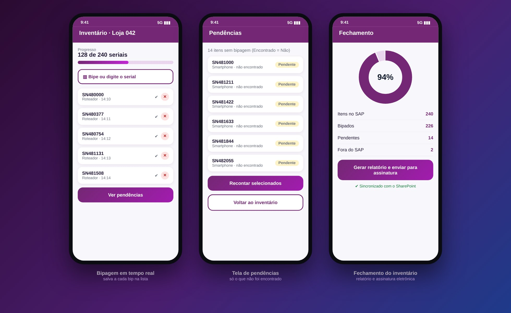
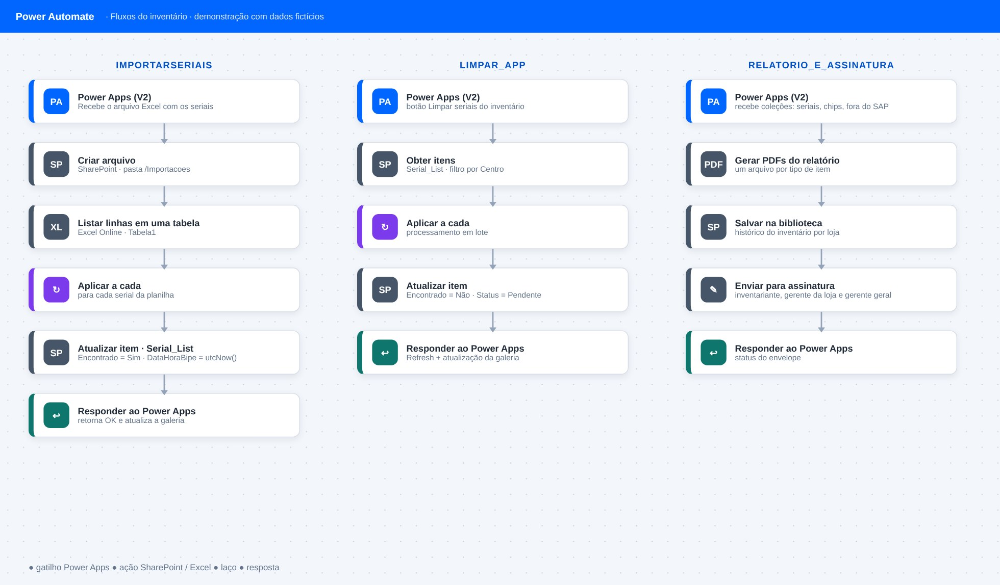
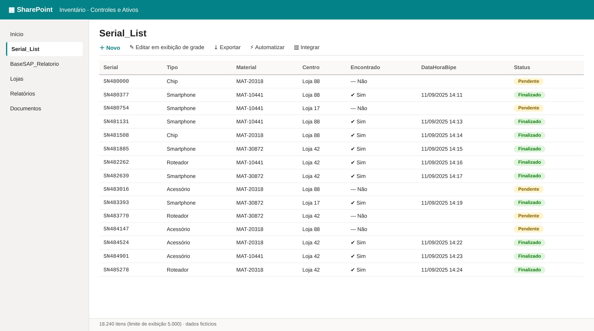

# App Digital Inventory

> Inventário de estoque por número de série em lojas, feito 100% em Power Platform.

**Tipo de tela:** Power Apps · Power Automate · SharePoint

    

[Ver esta página no site](https://mv-dev-finance.github.io/Portfolio_Automacoes_Financeiras/projects/digital-inventory.html) · [Voltar ao portfólio](../../README.md)

## 1. Lógica do negócio

No inventário físico, cada item com número de série precisa ser contado e comparado com o saldo do SAP. O que não é encontrado vira pendência, o que não pertence à loja é sinalizado, e as diferenças geram o ajuste contábil. Antes, a bipagem e a conferência eram manuais e demoradas.

**Regras que governam o processo**

- Todo serial do SAP precisa ser bipado ou justificado
- Serial já bipado, de outro centro ou fora do SAP é sinalizado
- Pendências são recontadas antes de finalizar
- O relatório final traz valores, diferenças e ajustes e segue para assinatura

> **O problema:** Bipagem completa de cerca de 2 horas e inventário de cerca de 5 horas, com consolidação manual e retrabalho depois da contagem.

## 2. Como resolvi com dados

1. **Carga da base SAP**: Bases do SAP (estoque por serial) alimentam a lista Serial_List no SharePoint.
2. **Bipagem no app**: O Power Apps registra cada bip, atualiza a galeria e salva automaticamente na lista.
3. **Pendências e recontagem**: Tela com só o que não foi encontrado; é possível remover um bip e recontar.
4. **Importação e lotes**: Power Automate importa seriais de um Excel e limpa a lista em lote, sem travar o app.
5. **Relatório e assinatura**: Prévia no app, PDFs finais, histórico no SharePoint e envio para assinatura eletrônica.

## 3. Tecnologias utilizadas

| Camada | Tecnologias |
|---|---|
| Fontes de dados | Bases do SAP (estoque por serial) |
| Bancos e SQL | SharePoint Lists (Serial_List) |
| Processamento | Power Fx, Power Automate |
| Interface | Power Apps (app de bipagem) |
| Entrega | Relatório final em PDF, Assinatura eletrônica (DocuSign), Histórico no SharePoint |
| Automação | Importação de seriais via Excel, Limpeza e atualização em lote |

## 4. Funcionalidades

- Salvamento automático a cada bip
- Remoção de bip com atualização sincronizada
- Tela de pendências (itens não encontrados)
- Controle de acesso por status da loja
- Feedback visual ao usuário
- Importação de seriais por Excel
- Relatório final e assinatura eletrônica

## Resultados

| Indicador | Resultado |
|---|---|
| Tempo de bipagem | 2 h → 1 h (≈ −50%) |
| Tempo total do inventário | 5 h → 3 h (≈ −40%) |
| Custo adicional de licenças | R$ 0 · plataformas já licenciadas |

## IA aplicada neste projeto

O Copilot ajudou em melhorias de código (Power Fx) e na criação de cenários de teste do aplicativo.

## Telas

**Power Apps**

**Power Automate**

**SharePoint**

## Quem fez

**Miguel Vinicius Moura Martins**: Desenhei o aplicativo e os fluxos, modelei as listas e validei o processo em campo, com apoio de IA em melhorias de código e cenários de teste.

> Todas as telas usam dados sintéticos de uma empresa fictícia.
