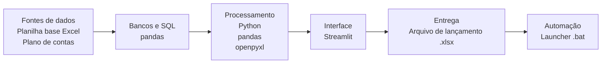
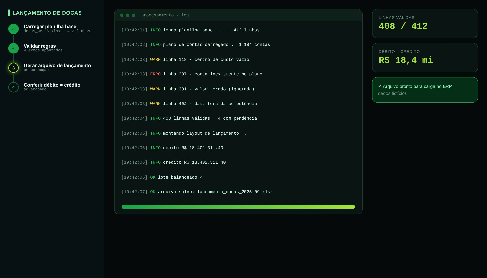

# Lançamento de Docas

> Da planilha base ao arquivo de lançamento contábil validado.

**Tipo de tela:** Wizard + log

   

[Ver esta página no site](https://mv-dev-finance.github.io/Portfolio_Automacoes_Financeiras/projects/lancamento-docas.html) · [Voltar ao portfólio](../../README.md)

## 1. Lógica do negócio

Alguns lançamentos recorrentes partem de uma planilha de apuração e precisam virar um arquivo de lançamento para o ERP. Todo lote precisa ter débito igual a crédito, contas e centros de custo válidos e competência correta.

**Regras que governam o processo**

- Débito = crédito em todo lote
- Conta e centro de custo precisam existir no plano de contas
- A data precisa estar dentro da competência

> **O problema:** Montar o lançamento manualmente aumentava o risco de erro de conta, centro de custo e lote desbalanceado.

## 2. Como resolvi com dados

1. **Leitura**: Carrego a planilha base.
2. **Validação**: Aplico regras de conta, centro de custo, valor e competência.
3. **Erros**: Listo cada erro com a linha e a ação sugerida.
4. **Geração**: Monto o arquivo de lançamento no layout do ERP.
5. **Conferência**: Confirmo débito = crédito antes de entregar.

## 3. Tecnologias utilizadas

| Camada | Tecnologias |
|---|---|
| Fontes de dados | Planilha base (Excel), Plano de contas |
| Bancos e SQL | pandas |
| Processamento | Python, pandas, openpyxl |
| Interface | Streamlit |
| Entrega | Arquivo de lançamento (.xlsx) |
| Automação | Launcher .bat |

## 4. Funcionalidades

- Validação por regra, linha a linha
- Log com avisos e erros
- Conferência automática de débito e crédito
- Arquivo pronto para carga

## IA aplicada neste projeto

Cenários de lote desbalanceado, conta inexistente e data fora da competência.

## Telas

**Processamento**

## Quem fez

**Miguel Vinicius Moura Martins**: Defini a regra de negócio, modelei os dados, validei os números contra o processo manual e desenvolvi a ferramenta com apoio de IA.

> Todas as telas usam dados sintéticos de uma empresa fictícia.
