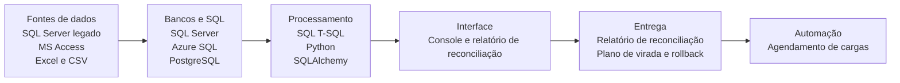
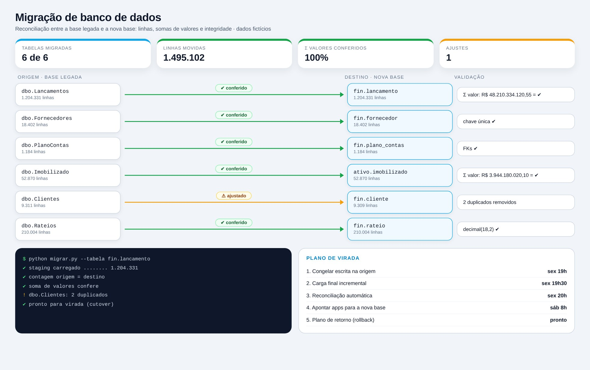

# Migração de Banco de Dados

> Migração entre bases com reconciliação de linhas, valores e integridade antes da virada.

**Tipo de tela:** Reconciliação origem × destino

      

[Ver esta página no site](https://mv-dev-finance.github.io/Portfolio_Automacoes_Financeiras/projects/migracao-banco-dados.html) · [Voltar ao portfólio](../../README.md)

## 1. Lógica do negócio

Migrar uma base não é só copiar tabelas: é provar que nada se perdeu. Isso exige mapear esquema e tipos, carregar por etapas, reconciliar contagens e somas de valores entre origem e destino e planejar a virada (cutover) com plano de retorno.

**Regras que governam o processo**

- Contagem de linhas igual entre origem e destino
- Soma de valores por período igual (valor monetário nunca em float)
- Chaves únicas e chaves estrangeiras preservadas
- Virada com janela definida e plano de retorno (rollback)

> **O problema:** Bases legadas em formatos e tipos diferentes, com risco de perder linhas, arredondar valores ou quebrar relatórios que dependem delas.

## 2. Como resolvi com dados

1. **Inventário e mapeamento**: Levanto tabelas, tipos e dependências e defino o de/para de esquema.
2. **Carga em etapas**: Staging, carga completa e depois incremental até a virada.
3. **Reconciliação**: Comparo contagens, somas e checksums tabela a tabela.
4. **Tratamento**: Corrijo duplicados e tipos antes de liberar.
5. **Virada e retorno**: Congelo a origem, carrego o final, valido e aponto os apps para a nova base.

## 3. Tecnologias utilizadas

| Camada | Tecnologias |
|---|---|
| Fontes de dados | SQL Server (legado), MS Access, Excel e CSV, Oracle |
| Bancos e SQL | SQL Server, Azure SQL, PostgreSQL, MySQL |
| Processamento | SQL (T-SQL), Python, SQLAlchemy, pandas |
| Interface | Console e relatório de reconciliação |
| Entrega | Relatório de reconciliação, Plano de virada e rollback |
| Automação | Agendamento de cargas |

## 4. Funcionalidades

- Reconciliação por tabela: linhas e somas
- Checagem de chaves e duplicados
- Tipos monetários em decimal
- Plano de virada e rollback
- Log de execução auditável

## IA aplicada neste projeto

Geração de cenários de divergência (duplicados, tipos numéricos, datas) para testar a reconciliação.

## Telas

**Reconciliação**

## Quem fez

**Miguel Vinicius Moura Martins**: Defini a regra de negócio, modelei os dados, validei os números contra o processo manual e desenvolvi a ferramenta com apoio de IA.

> Todas as telas usam dados sintéticos de uma empresa fictícia.
