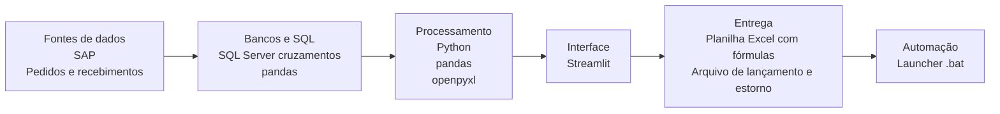
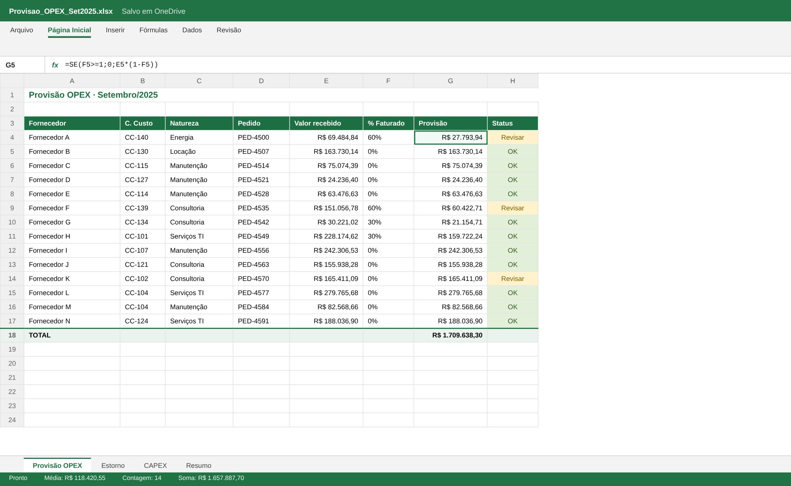
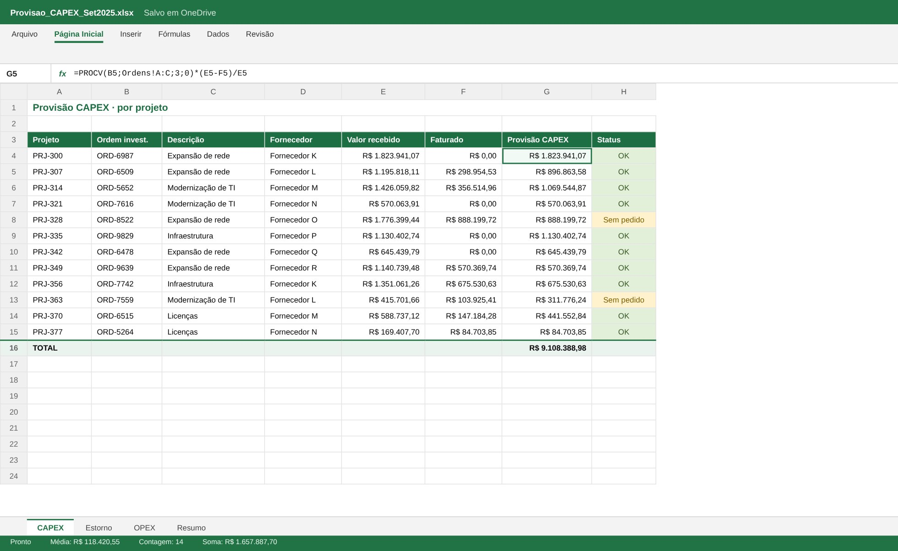

# Provisões OPEX e CAPEX

> Provisão de gastos incorridos e não faturados, com estorno e comparação com o orçado.

**Tipo de tela:** Planilhas Excel

     

[Ver esta página no site](https://mv-dev-finance.github.io/Portfolio_Automacoes_Financeiras/projects/provisoes-opex-capex.html) · [Voltar ao portfólio](../../README.md)

## 1. Lógica do negócio

Pelo regime de competência, a despesa pertence ao mês em que o serviço foi prestado ou o bem foi recebido, mesmo sem nota fiscal. No fechamento, provisiona-se o que foi incorrido e não faturado. No mês seguinte, quando a nota chega, a provisão é estornada para não duplicar. OPEX vai para o resultado e CAPEX vai para o imobilizado em curso.

**Regras que governam o processo**

- Incorrido e sem nota fiscal: provisionar no mês
- Nota recebida no mês seguinte: estornar a provisão
- OPEX afeta o resultado, CAPEX afeta o imobilizado
- Itens sem pedido, centro de custo ou ordem de investimento vão para revisão

> **O problema:** Montar a lista de provisões a cada fechamento, separando OPEX e CAPEX, gerando o lançamento e o estorno sem esquecer nada.

## 2. Como resolvi com dados

1. **Extração**: Pedidos, recebimentos e notas lançadas no período.
2. **Cruzamento**: Identifico o que foi recebido e ainda não faturado, por fornecedor e centro de custo.
3. **Regras**: Classifico em OPEX ou CAPEX por natureza, centro de custo e ordem de investimento.
4. **Lançamento**: Gero o lançamento de provisão e o estorno do mês seguinte.
5. **Entrega**: Planilha com fórmulas, comparação com o orçado e lista de itens a revisar.

## 3. Tecnologias utilizadas

| Camada | Tecnologias |
|---|---|
| Fontes de dados | SAP, Pedidos e recebimentos |
| Bancos e SQL | SQL Server (cruzamentos), pandas |
| Processamento | Python, pandas, openpyxl |
| Interface | Streamlit |
| Entrega | Planilha Excel com fórmulas, Arquivo de lançamento e estorno |
| Automação | Launcher .bat |

## 4. Funcionalidades

- Separação OPEX e CAPEX por regra
- Lançamento e estorno gerados automaticamente
- Comparativo orçado × realizado + provisão
- Lista de itens a revisar

## IA aplicada neste projeto

Casos com pedido sem recebimento, faturamento parcial e estorno no mês seguinte.

## Telas

**Provisão OPEX**

**Provisão CAPEX**

## Quem fez

**Miguel Vinicius Moura Martins**: Defini a regra de negócio, modelei os dados, validei os números contra o processo manual e desenvolvi a ferramenta com apoio de IA.

> Todas as telas usam dados sintéticos de uma empresa fictícia.
