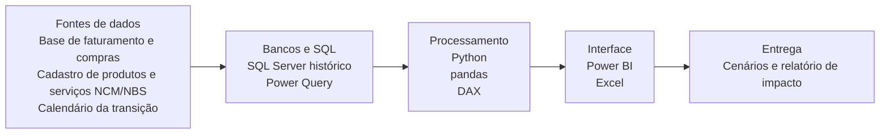
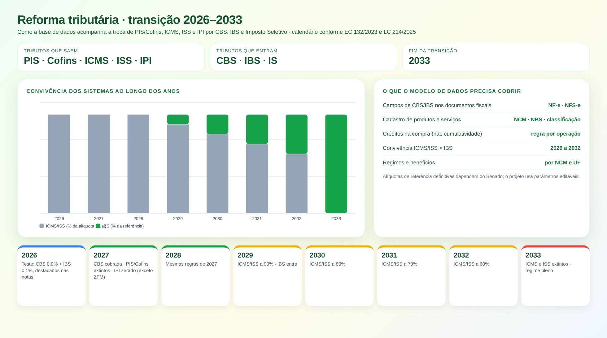
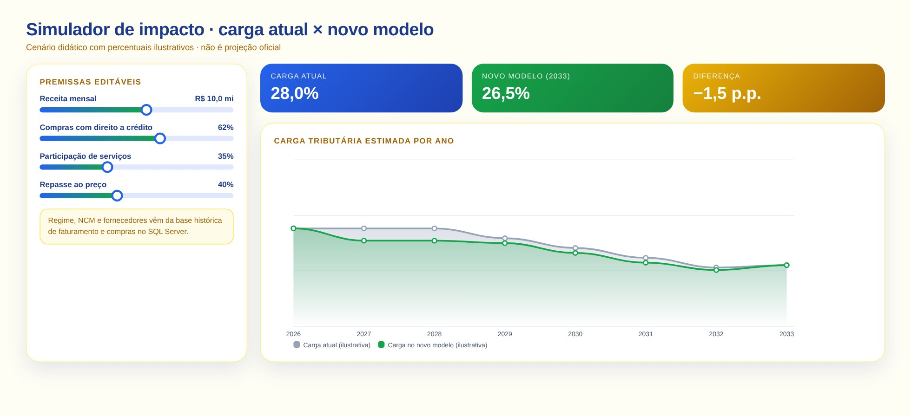

# Reforma Tributária: Transição e Simulador

> Acompanhamento da transição para CBS, IBS e Imposto Seletivo e simulação de impacto.

**Tipo de tela:** Linha do tempo + simulador

    

[Ver esta página no site](https://mv-dev-finance.github.io/Portfolio_Automacoes_Financeiras/projects/reforma-tributaria.html) · [Voltar ao portfólio](../../README.md)

## 1. Lógica do negócio

A reforma tributária do consumo (EC 132/2023 e LC 214/2025) substitui PIS, Cofins, ICMS, ISS e IPI por CBS, IBS e Imposto Seletivo, em uma transição de 2026 a 2033. Em 2026 há alíquotas de teste (CBS 0,9% e IBS 0,1%); em 2027 a CBS passa a ser cobrada e PIS/Cofins são extintos; de 2029 a 2032 ICMS e ISS caem a cada ano; em 2033 o novo regime fica pleno.

**Regras que governam o processo**

- 2026: teste com CBS 0,9% e IBS 0,1% destacados nos documentos
- 2027: CBS cobrada, PIS/Cofins extintos e IPI zerado (exceto Zona Franca de Manaus)
- 2029 a 2032: ICMS e ISS a 90%, 80%, 70% e 60% das alíquotas, com IBS crescente
- 2033: ICMS e ISS extintos e regime pleno de IBS e CBS

> **O problema:** Cada etapa muda uma variável diferente: documentos e cadastros, créditos, preço e caixa. Era preciso enxergar o impacto na base de dados da empresa, e não só no texto da lei.

## 2. Como resolvi com dados

1. **Mapeamento**: Levanto tributos atuais por operação, produto e serviço.
2. **Base histórica**: Modelo faturamento e compras em SQL, com NCM, NBS, regime e créditos.
3. **Calendário**: Parametrizo as regras e percentuais de cada ano da transição.
4. **Simulação**: Comparo a carga atual com o novo modelo por cenário.
5. **Entrega**: Painel de acompanhamento e relatório de impacto, com premissas editáveis.

## 3. Tecnologias utilizadas

| Camada | Tecnologias |
|---|---|
| Fontes de dados | Base de faturamento e compras, Cadastro de produtos e serviços (NCM/NBS), Calendário da transição |
| Bancos e SQL | SQL Server (histórico), Power Query |
| Processamento | Python, pandas, DAX |
| Interface | Power BI, Excel |
| Entrega | Cenários e relatório de impacto |

## 4. Funcionalidades

- Linha do tempo 2026–2033
- Participação de ICMS/ISS e IBS por ano
- Simulador com premissas editáveis
- Pendências de cadastro (NCM, NBS, regra de crédito)

## IA aplicada neste projeto

Simulação de cenários por ano da transição e revisão das premissas de cálculo. Percentuais do simulador são ilustrativos.

## Telas

**Transição 2026–2033**

**Simulador de impacto**

## Quem fez

**Miguel Vinicius Moura Martins**: Defini a regra de negócio, modelei os dados, validei os números contra o processo manual e desenvolvi a ferramenta com apoio de IA.

> Todas as telas usam dados sintéticos de uma empresa fictícia.
