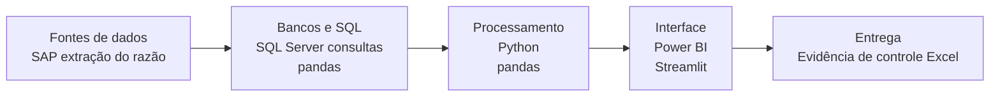
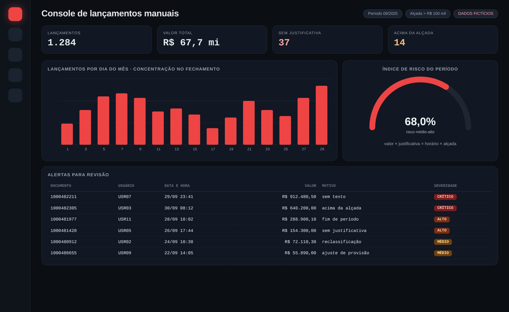

# Relatório de Lançamentos Manuais

> Trilha de auditoria dos lançamentos feitos fora das rotinas automáticas.

**Tipo de tela:** Console de auditoria

      

[Ver esta página no site](https://mv-dev-finance.github.io/Portfolio_Automacoes_Financeiras/projects/relatorio-lancamentos-manuais.html) · [Voltar ao portfólio](../../README.md)

## 1. Lógica do negócio

Lançamentos manuais fogem das rotinas automáticas e por isso são ponto clássico de atenção de controles internos e auditoria. O que se olha: valor alto, ausência de justificativa, concentração no fim do período, usuário atípico e alçada.

**Regras que governam o processo**

- Lançamentos manuais exigem justificativa e aprovação conforme a alçada
- Valores acima da alçada passam por revisão obrigatória
- Concentração no fim do período merece atenção
- A evidência precisa ser reproduzível para a auditoria

> **O problema:** Sem um relatório estruturado, era difícil ver quem lançou, quanto e se havia justificativa.

## 2. Como resolvi com dados

1. **Extração**: Documentos do razão no período, com usuário, tipo, data, valor e texto.
2. **Filtro**: Isolo o que é lançamento manual pelo tipo de documento e pela origem.
3. **Classificação de risco**: Pontuo por valor, falta de texto, horário e alçada.
4. **Destaques**: Separo os sem justificativa e os acima da alçada.
5. **Entrega**: Console de revisão e evidência de controle em Excel.

## 3. Tecnologias utilizadas

| Camada | Tecnologias |
|---|---|
| Fontes de dados | SAP (extração do razão) |
| Bancos e SQL | SQL Server (consultas), pandas |
| Processamento | Python, pandas |
| Interface | Power BI, Streamlit |
| Entrega | Evidência de controle (Excel) |

## 4. Funcionalidades

- Distribuição por dia do mês e por usuário
- Índice de risco do período
- Alertas por severidade
- Pronto para evidência de controle

## IA aplicada neste projeto

Cenários de lançamentos no fim do período e simulação de usuários atípicos para testar os alertas.

## Telas

**Console**

## Quem fez

**Miguel Vinicius Moura Martins**: Defini a regra de negócio, modelei os dados, validei os números contra o processo manual e desenvolvi a ferramenta com apoio de IA.

> Todas as telas usam dados sintéticos de uma empresa fictícia.
