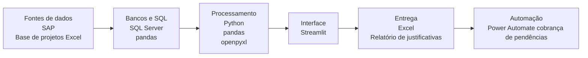
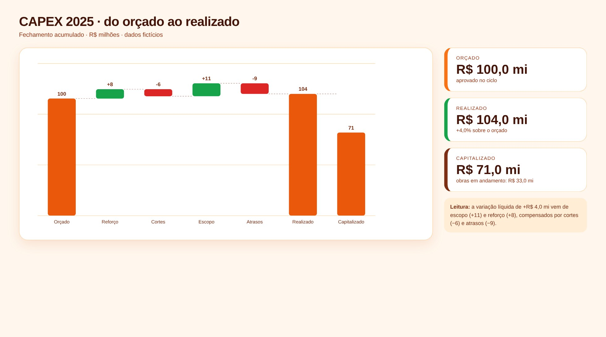
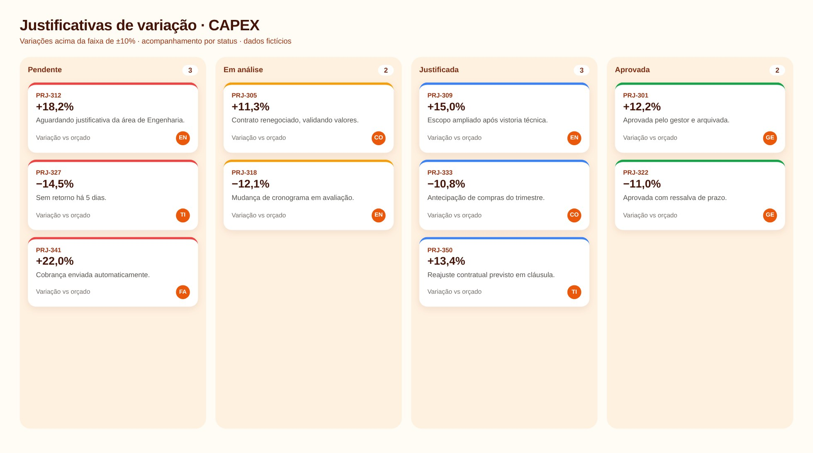

# Relatórios CAPEX: Fechamento e Justificativa

> Fechamento do CAPEX e justificativa das variações acima da faixa de tolerância.

**Tipo de tela:** Waterfall + Kanban

      

[Ver esta página no site](https://mv-dev-finance.github.io/Portfolio_Automacoes_Financeiras/projects/relatorios-capex.html) · [Voltar ao portfólio](../../README.md)

## 1. Lógica do negócio

CAPEX é o investimento em ativos de longo prazo. Enquanto a obra está em andamento, o valor fica em imobilizado em curso. Quando o ativo entra em operação, é capitalizado e passa a ser depreciado. A gestão acompanha orçado × realizado e exige justificativa quando a variação passa de uma faixa de tolerância.

**Regras que governam o processo**

- Orçado × realizado × capitalizado por projeto
- Obras em andamento ficam em imobilizado em curso até a ativação
- Variação fora da faixa exige justificativa da área
- Justificativas pendentes são acompanhadas por área

> **O problema:** Consolidar números de dezenas de projetos e correr atrás das justificativas manualmente todo mês.

## 2. Como resolvi com dados

1. **Extração**: Base de projetos com orçado, realizado e capitalizado.
2. **Consolidação**: Agrego por projeto, categoria e período, acumulado do ano.
3. **Filtro de tolerância**: Calculo a variação e separo o que ficou fora da faixa.
4. **Justificativas**: Gero a lista por área com campo para o motivo e o status.
5. **Entrega**: Waterfall do orçado ao realizado e quadro de justificativas.

## 3. Tecnologias utilizadas

| Camada | Tecnologias |
|---|---|
| Fontes de dados | SAP, Base de projetos (Excel) |
| Bancos e SQL | SQL Server, pandas |
| Processamento | Python, pandas, openpyxl |
| Interface | Streamlit |
| Entrega | Excel, Relatório de justificativas |
| Automação | Power Automate (cobrança de pendências) |

## 4. Funcionalidades

- Waterfall do orçado ao realizado
- Obras em andamento e capitalização
- Filtro automático das variações fora da faixa
- Quadro de justificativas por status

## IA aplicada neste projeto

Revisão das faixas de tolerância e cenários de variação positiva e negativa.

## Telas

**Fechamento**

**Justificativas**

## Quem fez

**Miguel Vinicius Moura Martins**: Defini a regra de negócio, modelei os dados, validei os números contra o processo manual e desenvolvi a ferramenta com apoio de IA.

> Todas as telas usam dados sintéticos de uma empresa fictícia.
