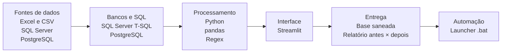
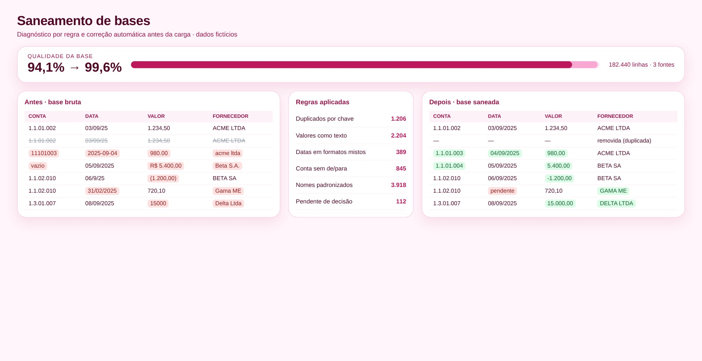

# Saneamento de Bases de Dados

> Diagnóstico e correção automática de qualidade de dados antes da carga.

**Tipo de tela:** Antes × depois

       

[Ver esta página no site](https://mv-dev-finance.github.io/Portfolio_Automacoes_Financeiras/projects/saneamento-bases-dados.html) · [Voltar ao portfólio](../../README.md)

## 1. Lógica do negócio

Decisões e conciliações são tão boas quanto a qualidade da base. Dados com duplicidades, campos vazios, formatos misturados ou contas sem de/para quebram cargas, cruzamentos e relatórios.

**Regras que governam o processo**

- Chave única por registro
- Campos obrigatórios preenchidos
- Datas e valores em formato padronizado
- Todas as contas com de/para

> **O problema:** Bases de várias fontes chegavam sujas e o retrabalho de limpeza se repetia a cada ciclo.

## 2. Como resolvi com dados

1. **Perfilamento**: Meço duplicados, nulos, formatos e contas sem de/para.
2. **Regras**: Defino regras por campo e por tipo de problema.
3. **Correção segura**: Corrijo automaticamente o que é seguro corrigir.
4. **Pendências**: Listo o que precisa de decisão humana.
5. **Prova**: Relatório de problemas antes × depois.

## 3. Tecnologias utilizadas

| Camada | Tecnologias |
|---|---|
| Fontes de dados | Excel e CSV, SQL Server, PostgreSQL, MySQL, MS Access, Oracle |
| Bancos e SQL | SQL Server (T-SQL), PostgreSQL |
| Processamento | Python, pandas, Regex |
| Interface | Streamlit |
| Entrega | Base saneada, Relatório antes × depois |
| Automação | Launcher .bat |

## 4. Funcionalidades

- Remoção de duplicados por chave
- Padronização de datas e valores
- De/para de contas
- Relatório antes × depois

## IA aplicada neste projeto

Geração de bases sujas sintéticas para testar cada regra de limpeza.

## Telas

**Antes × depois**

## Quem fez

**Miguel Vinicius Moura Martins**: Defini a regra de negócio, modelei os dados, validei os números contra o processo manual e desenvolvi a ferramenta com apoio de IA.

> Todas as telas usam dados sintéticos de uma empresa fictícia.
